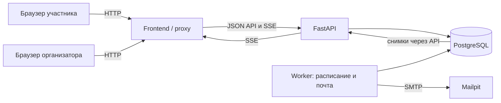
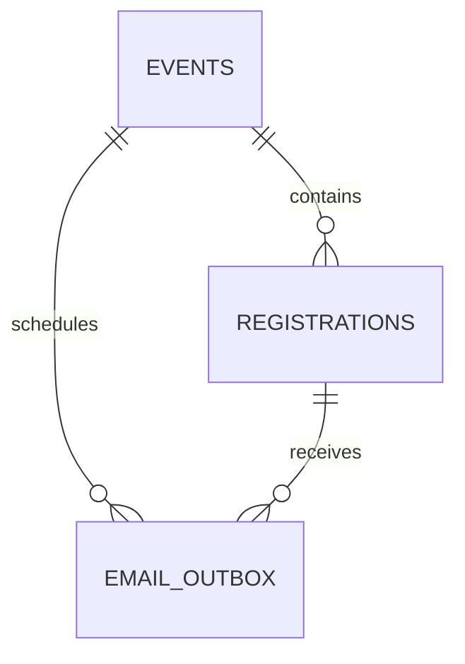

# Архитектура кейса №9 — предложение для согласования

Статус: предложено, не утверждено. Здесь описан будущий проект; кода приложения, миграций, контейнеров и тестов на этом этапе нет. Требования и критерии — в [REQUIREMENTS.md](REQUIREMENTS.md). Значения задержек и спорные правила ниже являются предложениями, а не дополнительными условиями PDF.

## 1. Состав и причины выбора

Модульный backend, отдельная SPA, PostgreSQL и локальная почта. Один backend-образ используется для API, worker и одноразового запуска миграций. Worker нужен, чтобы напоминания и отправка работали без открытого браузера и переживали рестарт API.

| Компонент | Ответственность и обоснование |
|---|---|
| Python + FastAPI + Pydantic | HTTP-контракт, валидация, понятные ошибки, OpenAPI; соответствуют выбранному стеку |
| SQLAlchemy + psycopg, синхронные Session | Явные короткие транзакции, знакомая модель доступа к PostgreSQL; одна Session на операцию, никакого совместного использования между потоками |
| Alembic | Воспроизводимая схема и её развитие; никаких create_all при обычном старте приложения |
| PostgreSQL | Единственный источник истины для мест, очереди, чекина и заданий почты; блокировки между любыми процессами API |
| Python worker, тот же код доменных сервисов | Периодическая подготовка напоминаний, отправка outbox, повтор после ошибок; без отдельного брокера |
| React + TypeScript + Vite | Небольшой интерфейс с типами API, формами и отображением серверного состояния |
| SSE (Server-Sent Events) | Одностороннее обновление статистики и даты; изменение данных идёт через обычный HTTP |
| Mailpit | Бесплатная локальная SMTP-почта с просмотром и проверкой писем; название подтверждено пользователем |
| Docker Compose | Единый локальный запуск, volumes, healthchecks и зависимости старта |
| Pytest + HTTPX; Vitest/Testing Library; Playwright | Проверки правил и API, небольшие проверки UI, критические сценарии двух браузеров |

Redis, Celery, Kafka, WebSocket-сервер и отдельные микросервисы не нужны для этого объёма. Точные совместимые версии и lockfiles фиксируются на этапе реализации; теги `latest` в воспроизводимой сдаче не использовать.



Compose-сервисы: `frontend`, `api`, `worker`, `db`, `mailpit`, завершающийся `migrate`. Миграции ждут готовую БД; API/worker стартуют после успешных миграций. Снаружи публикуются на 127.0.0.1 только frontend и Mailpit UI; внутренние DB/SMTP не требуют публичных портов. В production-сборке frontend-контейнер отдаёт статику и проксирует `/api`; отдельный процесс backend сохраняется. Для SSE отключается буферизация proxy и задаётся достаточный read timeout.

Первый build может скачивать пакеты и образы. После их загрузки приложение работает без интернета, платных аккаунтов и внешних API. Mailpit не пересылает письма наружу; его внешние проверки версий и SMTP reverse DNS отключаются. PostgreSQL и Mailpit используют постоянные volumes; `down -v` означает явное удаление данных и не входит в обычный перезапуск.

## 2. Границы backend и frontend

Backend:

- `api`: маршруты, входные/выходные схемы, проверка доступа, перевод ошибок в HTTP. Здесь нет подсчёта свободных мест и правил переходов.
- `services`: операции создать/перенести событие, зарегистрировать/отменить участие, провести чекин; здесь находятся транзакционные границы и бизнес-правила.
- `db`: модели, Session factory, конкретные SQL-запросы по мере необходимости. Не создавать универсальный Repository, интерфейсы для каждой модели или дополнительный Unit of Work поверх Session.
- `notifications`: формирование неизменяемого отправляемого сообщения, outbox, SMTP-адаптер и напоминания.
- `worker`: простой цикл с завершением по сигналу, backoff, обработкой просроченных захватов и логированием ошибок.
- `clock`: маленькая подменяемая функция времени для тестов. В рабочем коде время UTC; время бизнес-операции получают после захвата блокировки.

Синхронные HTTP handlers FastAPI выполняют DB-операции вне event loop. Асинхронный SSE-генератор получает короткий снимок через threadpool и освобождает Session/соединение до ожидания следующего тика. SMTP выполняется worker, вне транзакции регистрации. Абстракции вводятся только там, где нужна замена внешней границы, например времени или отправителя в тестах.

Frontend:

- список событий и страница события с формой email, датой, свободными местами;
- страница управления конкретной регистрацией: confirmed/waitlisted/cancelled, билет при наличии, отказ;
- экран организатора: создание, перенос, три счётчика и состояние соединения;
- экран чекина: событие, поле кода, результат и время первого чекина;
- общий API-клиент, типы ответов и один переиспользуемый hook SSE; локальное состояние форм, без Redux;
- сервер определяет доступность мест и результат операции. Отключение кнопки во время запроса улучшает UX, но не обеспечивает целостность;
- при потере сети показаны ошибка/переподключение и последний подтверждённый снимок, а не выдуманный ноль. Повтор мутации обрабатывается сервером безопасно.

## 3. Предлагаемая структура проекта

Это схема будущей структуры; каталоги и файлы приложения сейчас не создаются.

```text
MadDevs/
  docs/                         # исходное ТЗ, позже сценарий демонстрации
  REQUIREMENTS.md
  ARCHITECTURE.md
  DECISIONS.md
  DEVELOPMENT_LOG.md
  README.md                     # запуск, проверки, состояние, AI, заимствования
  ESSAY.md                      # итоговые 10 предложений
  compose.yaml
  .env.example
  .gitignore
  backend/
    pyproject.toml
    requirements.lock           # конкретный формат фиксации выбрать при сборке
    Dockerfile
    alembic.ini
    migrations/versions/
    app/
      main.py
      config.py
      clock.py
      api/{events,registrations,checkins,stats,health}.py
      schemas/
      services/{events,registrations,checkins}.py
      db/{session,models,queries}.py
      notifications/{outbox,reminders,smtp,templates}.py
      worker.py
    tests/{unit,integration}/
  frontend/
    package.json
    package-lock.json
    Dockerfile
    nginx.conf
    src/
      api/
      pages/
      components/
      hooks/useEventStats.ts
      types/
    tests/
  tests/e2e/
  .github/workflows/ci.yml
```

Исходный пустой `main.py` в корне уже существовал до этого этапа; он не является реализацией проекта. Его дальнейшую судьбу определить при создании backend, сейчас не менять.

## 4. Схема БД и инварианты

Три таблицы. Отдельные users, tickets и waitlist не нужны: билет и состояние очереди относятся к единственной регистрации на событие. Все даты — `timestamptz`, API требует смещение в ISO 8601. Интерфейс явно показывает `Asia/Almaty`; «за сутки» означает 24 часа до абсолютного момента начала.



| Таблица | Поля |
|---|---|
| events | `id UUID PK`, `title text`, `description text`, `starts_at timestamptz`, `capacity integer`, `next_waitlist_seq bigint default 0`, `schedule_version integer default 1`, `created_at`, `updated_at` |
| registrations | `id UUID PK`, `event_id FK`, `email text`, `email_normalized text`, `status text`, `participation_no integer default 1`, `waitlist_seq bigint nullable`, `ticket_code text nullable`, `manage_token_hash text`, `checked_in_at timestamptz nullable`, `cancelled_at timestamptz nullable`, `created_at`, `updated_at` |
| email_outbox | `id UUID PK`, `event_id FK`, `registration_id FK`, `kind text`, `dedup_key text UNIQUE`, `message_id text UNIQUE`, `participation_no integer`, `schedule_version integer`, `recipient text`, `payload jsonb`, `prepared_at timestamptz nullable`, `due_at timestamptz`, `status text`, `attempts integer`, `next_attempt_at timestamptz`, `lease_token UUID nullable`, `locked_until timestamptz nullable`, `sent_at timestamptz nullable`, `last_error text nullable`, `created_at`, `updated_at` |

`title` — небольшое удобство интерфейса, в PDF явно требуется описание. Статусы регистрации: `confirmed`, `waitlisted`, `cancelled`; пришедший остаётся `confirmed` с `checked_in_at`, поэтому не освобождает место.

Ограничения и индексы:

- `CHECK capacity > 0`, положительные номера версий/участия; `CHECK` допустимых статусов.
- `UNIQUE(event_id, email_normalized)` на всю жизнь записи, включая cancelled; нормализация в одном месте, DB CHECK требует уже обрезанное и приведённое к нижнему регистру значение.
- `UNIQUE(ticket_code)` для непустых значений; достаточно случайный непредсказуемый код, не последовательный ID. Код действителен только при `confirmed` и нужном `event_id`.
- `UNIQUE(event_id, waitlist_seq)` для ненулевых значений; индекс `(event_id, waitlist_seq) WHERE status='waitlisted'` для первого в очереди.
- `CHECK`: waitlisted имеет номер очереди и не имеет билета/чекина; confirmed имеет билет и не имеет номера очереди; checked_in_at допустим только у confirmed; cancelled имеет cancelled_at, не имеет активного билета/номера очереди/чекина.
- Индекс `(event_id, status)`; PK/индексы для токена управления; индекс outbox `(status, due_at, next_attempt_at)` и индекс просроченных processing.
- Outbox ссылается составным FK `(event_id, registration_id)` на соответствующую пару registrations; для этого у registrations дополнительный UNIQUE(event_id, id). Это не позволяет случайно привязать письмо к другому событию.
- `ON DELETE RESTRICT`: физическое удаление событий и регистраций не входит в объём. Отмена участия — изменение статуса.

Число мест и счётчики не храним отдельно: считаем по registrations. Инварианты: `0 <= checked_in <= confirmed <= capacity`; каждому активному email соответствует одна регистрация; свободное место при непустой очереди не выдаётся новому участнику в обход ожидающих. Межстрочное ограничение вместимости обычный CHECK не обеспечивает: его обеспечивает единый протокол блокировки во всех сервисах записи. Произвольный SQL в обход приложения не входит в этот протокол.

## 5. Транзакции: последнее место и FIFO

Все операции, меняющие состав, дату, очередь или чекин одного события, начинают с `SELECT ... FROM events WHERE id = ... FOR UPDATE` в транзакции `READ COMMITTED`. После ожидания блокировки выполняются новые запросы к registrations; нельзя использовать число мест, прочитанное до блокировки. Порядок блокировок всегда `event → registration → outbox`; операции с несколькими событиями, если появятся, обрабатывают их по одному.

Это сериализует короткие изменения внутри одного события и оставляет разные события независимыми. Блокировка живёт в PostgreSQL, а не в памяти одного Python-процесса. Поведение блокировок и свежих снимков описано в [PostgreSQL: Explicit Locking](https://www.postgresql.org/docs/current/explicit-locking.html) и [Transaction Isolation](https://www.postgresql.org/docs/current/transaction-iso.html).

### Регистрация

1. Проверить формат email, открыть транзакцию, захватить строку события; проверить, что начало ещё не наступило.
2. Найти запись по нормализованному email. Активный повтор не меняет место, очередь, билет и outbox. Повтор не раскрывает токен управления или код билета по одному email.
3. Для новой записи либо явного повторного вступления cancelled получить актуальное число confirmed. При восстановлении увеличить `participation_no`, выдать новый токен; старые токен/билет больше не действуют.
4. Если очередь непуста и есть свободные места, сначала заполнить их из очереди в FIFO-порядке. В штатном пути такое заполнение уже выполнено отменой; правило защищает и будущие изменения.
5. Если место осталось, назначить `confirmed` и новый билет, создать ticket-outbox. Иначе увеличить `next_waitlist_seq` у события и назначить `waitlisted` с полученным номером. Для ожидающего предложено отдельное письмо о постановке в очередь со ссылкой управления, без билета.
6. Создать/актуализировать ещё не отправленное напоминание по правилам §7. Commit состояния и outbox вместе; только после commit отвечать клиенту.

При capacity=1 запрос A первым захватывает событие и занимает место; B ждёт, затем видит confirmed=1 и становится waitlisted. Если A откатывается, B получает место. Одновременный одинаковый email даёт одну запись; UNIQUE остаётся дополнительной страховкой. При lock timeout — понятный повторяемый ответ 503, никакого частичного успеха; кратковременные deadlock/serialization errors допускают ограниченный повтор всей транзакции с новой Session.

### Отказ и продвижение

1. По секретному токену найти регистрацию, затем заблокировать её событие и заново проверить токен/актуальное состояние записи.
2. Повторный отказ cancelled — успешный no-op. У checked-in отказ запрещён; время начала также проверяется на сервере.
3. Waitlisted → cancelled просто удаляет участника из очереди. Confirmed → cancelled инвалидирует билет и освобождает одно место.
4. В этой же транзакции выбрать активного ожидающего с минимальным `waitlist_seq`, сделать confirmed, удалить номер очереди, создать билет и ticket-outbox. Commit публикует отмену и продвижение одновременно.

FIFO означает порядок успешного присвоения номера в сериализованной транзакции; это не клиентское время нажатия кнопки. Пропуски номеров допустимы. `SKIP LOCKED` при выборе участника очереди не используется: пропуск первого нарушил бы FIFO. Конкурентная новая регистрация ждёт event-lock и не может перехватить освобождённое место. Повторно вступивший после отказа получает новый номер в хвосте.

### Однократный чекин

Организатор выбирает событие и вводит код. После event-lock выполняется условное обновление только строки с этим событием, действующим билетом, `status='confirmed'` и `checked_in_at IS NULL`. Первый запрос записывает серверное время и получает успех; второй возвращает «уже отмечен» с первоначальным временем. Счётчик — агрегат БД, поэтому повторный запрос не увеличивает его. Неверный и чужой код не меняют состояние. После commit следующий SSE-снимок отражает чекин.

## 6. HTTP-контракты и доступ

| Метод / путь | Назначение / доступ |
|---|---|
| GET /api/events, GET /api/events/{id} | Публичный список и описание без email и секретов |
| POST /api/events | Создание, ключ организатора |
| PATCH /api/events/{id}/schedule | Перенос с expected_schedule_version, ключ организатора |
| POST /api/events/{id}/registrations | Email; новая запись возвращает результат и токен управления однократно; активный повтор — нейтральное подтверждение без секретов |
| GET /api/registration | Состояние и билет по Bearer-токену участника |
| POST /api/registration/cancel | Отказ по Bearer-токену участника |
| POST /api/events/{id}/check-ins | Код билета, ключ организатора |
| GET /api/events/{id}/stats | Публичные агрегаты без персональных данных |
| GET /api/events/{id}/stream | SSE, те же публичные агрегаты и актуальная дата |
| GET /api/health/live, GET /api/health/ready | Живость процесса и готовность БД/схемы |

Перенос использует optimistic version: устаревшее изменение возвращает 409, без перезаписи более нового решения. Повтор уже применённой даты — no-op, новой рассылки нет; новая фактическая дата увеличивает schedule_version и атомарно создаёт outbox каждому активному получателю. Получатели фиксируются в момент переноса под event-lock. Позднее зарегистрированный получает уже актуальные сведения, историческое письмо о переносе ему не нужно.

Предложение по доступу: общий `ORGANIZER_TOKEN` из backend environment, вводимый организатором в UI и передаваемый заголовком; не включать в Vite bundle. В UI хранить только на время сессии. Управление участием — случайный длинный токен, в регистрации хранится его хеш. Ссылка из письма передаёт токен через fragment; frontend извлекает его, убирает из адресной строки и использует Authorization. GET никогда не отменяет участие. Секретные URL/токены не писать в логи. Outbox содержит данные письма, включая ссылку, поэтому сам тоже считается чувствительным хранилищем.

Новый запрос по уже зарегистрированному email не возвращает чужой билет/токен. Восстановление утраченной ссылки по отдельному email-flow не входит в минимальный объём; для демонстрации ссылка остаётся в Mailpit. Общий ключ — компромисс локального тестового задания, а не полноценная многопользовательская авторизация.

Ошибки содержат стабильный машинный code и понятное сообщение. 422 — неверный ввод; 401/403 — нет доступа; 404 — неизвестное событие/билет; 409 — запрещённый переход, повторный чекин или конфликт версии; 503 — временная недоступность. Вместимость, токены и временные ограничения всегда проверяются backend независимо от UI.

## 7. Email, напоминания и восстановление после сбоев

### Транзакционный outbox

Регистрация, продвижение и перенос создают задания в той же транзакции, что и бизнес-изменение. До commit worker их не видит. Письмо не отправляется из HTTP handler или недолговечного FastAPI BackgroundTasks. Ошибка SMTP не откатывает уже выделенное место: задание остаётся в БД.

| Вид | Получатели / ключ логического письма |
|---|---|
| ticket | Назначенный confirmed, в том числе из очереди; `ticket:{registration_id}:{participation_no}`. На одно участие билет назначается только однажды |
| waitlist | Новый ожидающий; `waitlist:{registration_id}:{participation_no}`. Дополнительное удобство для доступа к своей записи, без действующего билета |
| reminder | Все активные регистрации, включая очередь; `reminder:{event_id}:{registration_id}` без версии даты и номера повторного участия |
| rescheduled | Все активные в момент переноса; `rescheduled:{event_id}:{schedule_version}:{registration_id}` |

Состояния outbox: `pending → processing → sent`; при временной ошибке — повтор pending с next_attempt_at; при неактуальности до начала отправки — cancelled; при постоянной ошибке/исчерпании попыток — failed с видимой диагностикой и документированной командой повторной обработки после устранения причины. UNIQUE(dedup_key) исключает повторную постановку одного логического уведомления. Повтор задания не меняет Message-ID.

Worker работает циклом: подготовить актуальные напоминания, затем обработать ограниченную порцию готовых писем; эти задачи не должны вытеснять друг друга. Начальная цель — проход раз в секунду, ограниченный SMTP timeout, backoff с верхней границей. Кандидаты выбираются без долгих блокировок. Для захвата письма worker берёт event-lock, затем строку outbox, проверяет due_at, статус и участие, сохраняет lease_token/locked_until и commit. Не держать event-lock во время SMTP. После отправки результат записывается только владельцем того же lease_token; просроченный processing доступен повторной обработке. Так рестарт не теряет письмо; stale worker не перезаписывает результат нового владельца. Случай двух worker и истечения lease входит в проверку, хотя штатно запускается один.

Перед первой попыткой отправки под event-lock проверяются актуальный статус, participation_no, время и версия события. Отменённые или устаревшие билетные задания, ещё не начавшие отправку, отменяются. В момент захвата задаётся prepared_at и фиксируется payload для повторов. После первой попытки нельзя менять содержание под тем же Message-ID: неизвестно, принял ли SMTP предыдущую попытку. Утраченный lease не означает разрешение заново собрать письмо с новым содержанием.

Повтор с уже заполненным prepared_at использует сохранённое сообщение, даже если технический статус снова pending; его нельзя трактовать как новое неотправленное задание и отменять из-за смены участия. Для reminder, отменённого до первой попытки, повторное вступление реактивирует ту же строку: обновляет participation_no, данные и срок, сохраняя dedup_key/Message-ID. Sent или уже подготовленное reminder повторное вступление не сбрасывает. Поэтому простой `ON CONFLICT DO NOTHING` недостаточен для восстановления ещё не начатого напоминания; нужна проверка состояния под event-lock.

### Что именно означает «ровно одно»

БД гарантирует одно логическое задание. Обычный SMTP без идемпотентного получателя не гарантирует единственную доставку: worker может упасть после принятия письма SMTP, но до записи sent. Отказ от повторов создаёт риск потери, повтор — риск дубля.

Для согласованного локального контура предлагается доставлять в Mailpit со стабильным Message-ID вида `<outbox-UUID@events.local>` и включить `MP_IGNORE_DUPLICATE_IDS=true`. Хранить Mailpit DB на volume, отключить автоудаление (`MP_MAX_MESSAGES=0`, без лимита возраста). Mailpit документирует подавление одинаковых Message-ID и постоянное хранилище в [Runtime options](https://mailpit.axllent.org/docs/configuration/runtime-options/); применение к повторной SMTP-загрузке описано в [Importing messages](https://mailpit.axllent.org/docs/integration/importing/).

Из этого следует проектная гипотеза, которую обязательно подтвердить на закреплённой версии: повторная отправка после неоднозначного сбоя оставляет в Mailpit одно видимое письмо. Гарантия относится к нашему локальному получателю с сохранённой базой, а не к произвольному реальному SMTP. Сценарий kill worker после SMTP accept, рестарт Mailpit и повтор с тем же ID — обязательный приёмочный тест C13. Если он не проходит, C13 не считается выполненным; архитектурное решение пересматривается, а не заменяется обещанием «почти один раз».

Очистка Mailpit между попытками уничтожает данные для дедупликации; это ограничение фиксируется в README. В пределах одного запуска/перезапуска объём писем не очищается автоматически. API Mailpit используется только локально в тестах для подсчёта и проверки сообщений.

### Напоминания, время и перенос

Для active-регистрации хранится задание на `starts_at − 24h`. На новом участии и переносе задания создаются/обновляются транзакционно, а периодическая сверка восстанавливает отсутствующее расписание с тем же dedup_key. Сверка обрабатывает события по одному под event-lock; состояние в памяти не является расписанием.

- В штатном случае: одно письмо каждому confirmed и waitlisted, когда наступил срок. Ожидающему сообщить, что он пока в очереди.
- До первой попытки отправки перенос обновляет due_at, версию и данные reminder. Отмена исключает ещё не начатое напоминание.
- Уже sent напоминание после переноса или повторного вступления не создаётся заново. Новую дату сообщает rescheduled. Это предложенное прочтение «ровно одно», требующее согласования.
- Поздний вход/перенос в пределах 24 часов и восстановление после простоя: просроченное, ещё не отправленное задание выполняется при ближайшем проходе до starts_at. После начала напоминания без начатой попытки помечаются cancelled; невозможно честно доставить их задним числом.
- Подготовленное к отправке письмо может физически прийти после конкурентного отказа/переноса: отправку за пределами транзакции уже нельзя отозвать. Точка упорядочивания — захват задания под event-lock. Такое сообщение остаётся неизменным при повторе; письмо о переносе содержит актуальную дату. Старый билет после отказа всё равно не пройдёт чекин.
- Письма о разных переносах содержат версию и старую/новую дату; при быстрых последовательных переносах сохраняются отдельные уведомления. В штатном одном worker отправлять их по порядку версии; при сбоях пользователь сверяет актуальное состояние по ссылке.

Точность обычной локальной доставки — целевой предел 5 секунд после due_at при доступных worker, DB и Mailpit. При простое невозможно гарантировать физическую доставку точно за сутки; тесты и описание состояния должны явно различать штатный сценарий и восстановление.

## 8. Live-обновления

Предлагается SSE со снимком БД раз в секунду. Это поток свежего состояния, не журнал бизнес-событий и не обещание мгновенной доставки каждой промежуточной цифры. Для двух клиентов такой подход проще устойчивой публикации событий и даёт измеримый предел обновления.

1. При подключении сервер сразу читает и отправляет снимок: event_id, starts_at, schedule_version, confirmed, waitlisted, checked_in, server_time.
2. Каждую секунду один короткий SQL-запрос формирует все поля в одном MVCC-снимке; Session закрывается до ожидания. Не собирать три счётчика отдельными запросами с разными снимками.
3. При изменении полезных полей отправляется новый `stats` event; heartbeat поддерживает соединение независимо от изменений. Счётчики не инкрементируются на клиенте, а заменяются снимком.
4. Браузер переподключается после разрыва и получает полный свежий снимок. Replay всех промежуточных событий/Last-Event-ID не нужен для текущих агрегатов; рестарт API не теряет бизнес-состояние.
5. При событии SSE страница управления заново получает собственную регистрацию с токеном. SSE не содержит email, кодов билетов и токенов. На reconnect/focus также обновляется личное состояние; не позволять старому HTTP-ответу затереть более свежий.
6. Долгое отсутствие heartbeat переводит UI в состояние «нет связи»; после восстановления статистика сходится с БД без reload.

Критерий C15/U-сценария: изменение committed в клиенте A видно в B не позднее 2 секунд в здоровом локальном окружении. Это включает чекин, регистрацию, очередь, отмену и дату. Стоимость — приблизительно один короткий запрос в секунду на открытый stream; нагрузка от тысяч соединений вне текущего масштаба. Если измерение не укладывается в предел, сначала проверить buffering, timeouts и запрос, затем рассмотреть PostgreSQL LISTEN/NOTIFY как ускорение поверх обязательного восстановления снимком.

## 9. Стратегия проверки

Unit-тесты используют подменяемые clock/SMTP, интеграционные — настоящий PostgreSQL с миграциями. SQLite не доказывает блокировки PostgreSQL. Внешние SMTP и интернет для тестов не нужны.

| Слой / сценарий | Проверка и связанное требование |
|---|---|
| Unit | Нормализация email, временные границы, переходы статусов, получатели, ключи дедупликации; C02/C09/C12/C13/C16, A01–A06 |
| API + DB | Валидация, ограничения, ошибки доступа, корректность токенов, билет чужого события, stale schedule_version; C01–C09/C16, G05 |
| Последнее место | Два независимых подключения/Session и одновременный старт через barrier, capacity=1: ровно 1 confirmed + 1 waitlisted, оба ответа корректны; дополнительно 20 запросов на 3 места: 3/17; C11 |
| Одинаковый email | Параллельные запросы с одинаковым нормализованным адресом: одна строка, один билет/outbox; C09 |
| FIFO | Сначала создать известный A/B/C порядок, затем конкурентные отмены и новую регистрацию D; продвижение по waitlist_seq, без пропуска первого; при равновременном вступлении проверять присвоенный порядок, не время клиента; C04/C10 |
| Повторный отказ / rollback | Два отказа освобождают одно место; принудительная ошибка между изменением и outbox откатывает оба; C03/C08/C10 |
| Чекин | Конкурентные запросы одного билета: одно изменение; гонка с отказом/границей начала оставляет допустимое состояние; неизвестный/отменённый/чужой билет не проходит; C05/C06/C14 |
| Согласованность статистики | Снимок подтверждённых, ожидающих, пришедших соответствует DB при конкурентных изменениях; checked_in включены в confirmed; C07 |
| Scheduler | Управляемое now: до, в момент и после −24h; многократный tick, поздний участник, отмена, перенос до/после sent, простой через deadline и starts_at; C12/C13/C16 |
| SMTP + Mailpit | Проверить адрес, тело, код, ссылку и количество сообщений через локальный API; напоминание ожидающему не является билетом; C08/C10/C12/C13/C16 |
| Fault injection почты | Ошибка до send, timeout/accept с потерянным ответом, kill после accept до sent, просроченный lease, два worker, рестарт Mailpit с volume; один Message-ID и одно видимое письмо; C13 |
| Frontend | Отображение трёх статусов, ошибок API, «уже отмечен», состояния offline и дат; не дублировать все backend-проверки в unit-тестах UI |
| E2E Playwright | Два независимых browser context: событие на 1 место → регистрация A и очередь B → отказ A → билет B в Mailpit → чекин B → live-счётчик; перенос → письма всем active; G11/C01–C16 |
| Reconnect / restart | Разорвать SSE, сделать операции, подключиться снова; перезапустить API/worker/DB без удаления volumes; состояние и задания сохраняются; G04/G11/C13/C15 |
| Чистый запуск | Клон, .env по примеру, Compose build/up, миграции до head, ready, демонстрация и команды тестов; без ручных исправлений; G08/G09/G13/G14 |
| Сдача документов | Проверить ссылки, реальные даты/коммиты, модель/инструмент, заимствования, состояние и ровно 10 предложений эссе; G06/G07/G12/G15–G18/U04/U05/U07 |

Гонки синхронизируются барьерами и отдельными транзакциями; случайный sleep и последовательный TestClient не являются доказательством. Тесты конфликтов не должны целиком жить внутри одной внешней rollback-транзакции фикстуры: нужны реальные commits и изоляция между тестами. Проверить работу через несколько процессов API хотя бы для последнего места и чекина, чтобы исключить случайную зависимость от Python mutex.

Для времени применять инъекцию clock, а не ждать сутки. Сквозную доставку проверять настоящим worker и Mailpit, не только вызовом mock. В CI запланированы backend unit/integration, frontend typecheck/build и E2E критического пути; после реализации хранить реальные результаты, а не будущие команды как доказательство успеха. Общий процент coverage не заменяет проверки инвариантов.

## 10. Риски, ограничения и следующие улучшения

| Риск | Решение / проверка | Остаточное ограничение |
|---|---|---|
| Переполнение при обходе event-lock | Единые сервисы, порядок блокировок, конкурентные тесты каждого пути | Прямые изменения DB вне приложения должны соблюдать тот же протокол |
| Задержка от event-lock / deadlock | Короткие транзакции, отсутствие SMTP под блокировкой, один порядок, timeout и ограниченный retry | Одно очень популярное событие сериализует изменения; достаточность измерять, не обещать произвольный масштаб |
| Дубликат email после неоднозначного SMTP-сбоя | Outbox + стабильный Message-ID + Mailpit dedup + fault injection | Гарантия ограничена локальным Mailpit с сохранённой БД; на внешний SMTP автоматически не переносится |
| Недоставленное письмо | Персистентное расписание, retries, failed с диагностикой, процедура повторной обработки | Во время длительного простоя невозможно доставить точно в срок |
| Перенос или отказ одновременно с отправкой | Проверка под event-lock до prepared_at, затем неизменяемое письмо и актуальное состояние по ссылке | Уже начатую внешнюю отправку нельзя атомарно отменить вместе с БД |
| Разночтение «всем» и «ровно одно» после переноса | A01–A03 явно вынесены на согласование | До согласования нельзя считать продуктовую семантику окончательной |
| Ошибка часового пояса | UTC/timestamptz, aware ISO 8601, явный Asia/Almaty, тесты границ | Профиль с произвольной пользовательской зоной не входит в кейс |
| Утечка доступа | Хеш токена участника, секрет организатора вне сборки, без PII в SSE/логах, localhost | Общий ключ не даёт индивидуального аудита; Mailpit видит все локальные письма |
| Потеря данных | Volumes, документированный restart, запрет автоочистки Mailpit при проверках | Резервное копирование и восстановление вне минимального объёма; удаление volumes необратимо без копии |
| SSE proxy buffering / stale UI | Настройки proxy, heartbeat, reconnect snapshot, два реальных браузера | Тысячи streams требуют оптимизации; текущий проект рассчитан на демонстрационный масштаб |
| Случайно нестабильные тесты | Барьеры, управляемое время, отдельные БД/фикстуры, условия вместо произвольных ожиданий | Лимиты задержки проверяются на доступном здоровом локальном окружении |

Вне минимального объёма: полноценные аккаунты/RBAC, QR-сканер, платная/реальная доставка email, Redis/Celery, горизонтальное масштабирование live-потока, отмена всего мероприятия, изменение лимита, экспорт участников, восстановление секретной ссылки, production deployment. После обязательного объёма приоритетны индивидуальный доступ организаторов, ограничение злоупотреблений, восстановление ссылки и резервное копирование. Ни один пункт C01–C16 не исключён из обязательного объёма.

## 11. Порядок следующих этапов

1. Пользователь принимает или корректирует решения D01–D10 и уточнения A01–A09. До этого только документы.
2. Каркас, Compose, миграции, подтверждённый локальный запуск; затем реальный первый согласованный коммит.
3. Регистрация, FIFO и чекин вместе с конкурентными PostgreSQL-тестами.
4. Outbox, Mailpit, напоминания и перенос; проверить идемпотентность получателя при сбоях до объявления C13 выполненным.
5. Frontend, SSE и сценарии двух клиентов.
6. Итоговая проверка с чистого окружения, GitHub, README, обновлённые журналы, описание AI, состояния/улучшений и отдельное эссе.

Каждый этап фиксируется в журнале по факту. На текущем этапе функциональные тесты не запускаются: реализации для них ещё нет.
