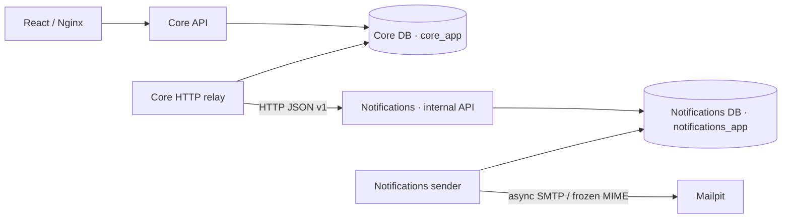
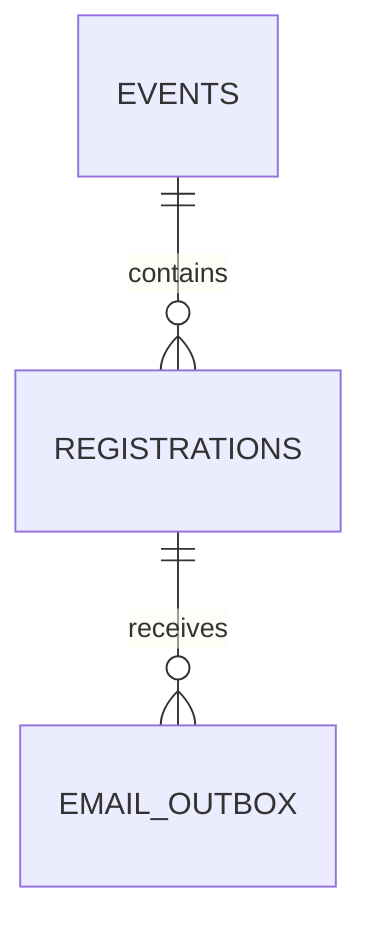

# Архитектура кейса №9

Статус: редакция 3 схемы (24 поля) разрешена пользователем к реализации 2026-10-21; остальной контракт редакции 2 принят пользователем как основа реализации сообщением «Начнем реализацию» от 2026-10-20. Добавлен этап backend services/API/outbox от 2026-10-22: фактическая готовность описана в [README.md](README.md), а ниже сохранён целевой контракт всего проекта. Core, Notifications/SMTP, frontend и SSE реализованы; пользовательская приёмка и финальная сдача остаются. Требования и критерии — в [REQUIREMENTS.md](REQUIREMENTS.md). Сравнение очередей — §12, SSE/WebSocket — §8, изоляции — §5; расширяемость — §13, краткая таблица изменений — §14. Обновлённый план будущих нескольких worker — [docs/WORKER_EVOLUTION.md](docs/WORKER_EVOLUTION.md); сейчас конкурентная отправка и leases не реализуются.


Актуализация 2026-10-23: пользователь согласовал Core + Notifications без брокера и уточнил, что Core владеет неизменяемым payload, а Notifications формирует/сохраняет MIME. Реализованы отдельные сервис/БД/роль/миграции/health, асинхронный HTTP relay и идемпотентный inbox Notifications. Реализованы также отдельный async SMTP sender, фиксация MIME и устойчивые повторы; [SMTP-контракт](docs/SMTP_DELIVERY.md). Операционные детали — [docs/NOTIFICATIONS_INFRASTRUCTURE.md](docs/NOTIFICATIONS_INFRASTRUCTURE.md). Схема Core, бизнес-сервисы и публичные маршруты сохранены.

## 1. Состав и причины выбора

Core и Notifications — отдельные Python-проекты, React — существующая SPA. Один PostgreSQL хранит две БД с разными обычными ролями. Core-образ используется API, последовательным HTTP relay и миграциями Core; Notifications имеет свой образ/миграции и защищённый приём. Реализован один последовательный SMTP-отправитель Notifications; leases, брокер и конкурентная отправка не добавлены.

| Компонент | Ответственность и обоснование |
|---|---|
| Python + FastAPI + Pydantic | HTTP-контракт, валидация, понятные ошибки, OpenAPI; соответствуют выбранному стеку |
| SQLAlchemy AsyncSession + asyncpg | Неблокирующий SQL через await; одна сессия на операцию/asyncio-задачу, короткие явные транзакции; PostgreSQL сохраняет роль координатора конкуренции |
| Alembic | Воспроизводимая схема и её развитие; никаких create_all при обычном старте приложения |
| PostgreSQL | Единственный источник истины для мест, очереди, чекина и заданий почты; блокировки между любыми процессами API |
| Core worker и отдельный Notifications | Worker проверяет Core DB и передаёт готовый payload по HTTP, Notifications идемпотентно фиксирует задание до 202. Notifications один раз фиксирует MIME и отправляет вне DB-транзакции. Расписание остаётся в Core outbox |
| React + TypeScript + Vite | Небольшой интерфейс с типами API, формами и отображением серверного состояния |
| SSE (Server-Sent Events) | Одностороннее обновление статистики и даты; изменение данных идёт через обычный HTTP |
| Mailpit | Бесплатная локальная SMTP-почта с просмотром и проверкой писем; название подтверждено пользователем |
| Docker Compose | Единый локальный запуск, volumes, healthchecks и зависимости старта |
| Pytest + HTTPX; Vitest; Playwright | Проверки правил и API, небольшие проверки UI, критические сценарии двух браузеров |

Core + Notifications — согласованное разделение на два сервиса; дальнейшее дробление, Redis, Celery, Kafka и WebSocket-сервер сейчас не нужны. Runtime/dev зависимости и базовые образы закреплены lock-файлами и digest. Vitest и Playwright установлены как dev dependencies; Testing Library не понадобилась, проверка UI делается реальным браузером. Prettier проверяет читаемый TSX/CSS, runtime dependencies по-прежнему только React/React DOM.



Обе БД находятся в одном PostgreSQL. Core relay вызывает Notifications по внутреннему HTTP; Notifications sender вызывает Mailpit по SMTP; Core SMTP не использует и не имеет SMTP-настроек. Core API не получает зависимости от готовности Notifications.


Compose-сервисы: `frontend`, `api`, `worker`, `notifications`, `notifications-sender`, `db`, `mailpit`; одноразовые `db-bootstrap`, `migrate`, `notifications-migrate`. Миграции ждут готовую БД; API/worker стартуют после успешных миграций. Каждый из Core relay и Notifications sender запускается в одном экземпляре, в том числе при обновлении: старый процесс должен полностью завершиться до старта нового; rolling replacement с перекрытием запрещён. При зависании старого процесса его сначала останавливают/завершают, а не запускают второй рядом. Это эксплуатационное условие упрощённой схемы, не распределённая гарантия singleton. Вручную запущенные параллельные отправители не поддерживаются. Снаружи на 127.0.0.1 публикуются frontend, Mailpit UI и PostgreSQL (default 5433); SMTP и API доступны только внутри Compose. В production-сборке frontend-контейнер отдаёт статику и проксирует `/api`; отдельный процесс backend сохраняется. Для SSE отключается буферизация proxy и задаётся достаточный read timeout. Nginx использует Docker resolver 127.0.0.11 с valid=5s и переменную upstream, чтобы заново получать IP после пересоздания API; это исправление реально обнаруженного 502, без новых runtime-сервисов.

Первый build может скачивать пакеты и образы. После их загрузки приложение работает без интернета, платных аккаунтов и внешних API. Mailpit не пересылает письма наружу; его внешние проверки версий и SMTP reverse DNS отключаются. PostgreSQL и Mailpit используют постоянные volumes; `down -v` означает явное удаление данных и не входит в обычный перезапуск.

## 2. Границы backend и frontend

Backend:

- `api`: маршруты, входные/выходные схемы, единые функции проверки доступа и перевода ошибок в HTTP. Здесь нет подсчёта свободных мест и правил переходов.
- `services`: операции создать/перенести событие, зарегистрировать/отменить участие, провести чекин; здесь находятся транзакционные границы и бизнес-правила.
- `db`: модели, async_sessionmaker/AsyncEngine, конкретные SQL-запросы по мере необходимости. Не создавать универсальный Repository, интерфейсы для каждой модели или дополнительный Unit of Work поверх Session.
- `notifications` внутри Core: запись уведомлений/сроков в текущую Session; фиксация неизменяемого payload и HTTP-передача. SMTP и MIME находятся в отдельном проекте Notifications. Helpers не делают commit внутри бизнес-операции.
- `worker` Core: последовательный async relay с HTTP deadline/backoff, фиксацией payload и завершением по сигналу. Задания не удерживаются только в памяти, аренды и поиск просроченных захватов не нужны.
- `clock`: маленькая подменяемая функция времени для тестов. В рабочем коде время UTC; время бизнес-операции получают после захвата блокировки.

HTTP handlers и функции сервисов — async def; DB-операции выполняются через AsyncSession и await, без синхронного драйвера или threadpool в HTTP-пути БД. SSE-генератор получает короткий снимок через AsyncSession и освобождает сессию/соединение до ожидания следующего тика. Async SMTP выполняется только в Notifications, вне транзакций Core. Для замены времени или отправителя в тестах достаточно передаваемой функции; интерфейсная иерархия не требуется. Внутри каждого проекта это границы модулей без обязательных промежуточных слоёв; Core и Notifications — отдельные сервисы.

Frontend:

- список событий и страница события с формой email, датой, свободными местами;
- страница управления конкретной регистрацией: confirmed/waitlisted/cancelled, билет при наличии, отказ;
- экран организатора: создание, перенос, три счётчика и состояние соединения;
- экран чекина: событие, поле кода, результат и время первого чекина;
- общий API-клиент, типы ответов и один переиспользуемый hook SSE; локальное состояние форм, без Redux;
- сервер определяет доступность мест и результат операции. Отключение кнопки во время запроса улучшает UX, но не обеспечивает целостность;
- при потере сети показаны ошибка/переподключение и последний подтверждённый снимок, а не выдуманный ноль. Повтор мутации обрабатывается сервером безопасно.

С 2026-10-22 Core API переведён на `AsyncEngine`/`async_sessionmaker(expire_on_commit=False)` и asyncpg. Сессия создаётся async dependency на запрос, транзакцию открывает сервис через `async with session.begin()`. Helpers принимают ту же AsyncSession, вызываются с await и не делают собственный commit. Проверки времени после event-lock, отдельный SELECT MAX при READ COMMITTED, атомарность продвижения/outbox, версии и токены сохранены. Нет ORM relationships с неявным lazy-loading; I/O явно ожидается. Lifespan и worker вызывают await engine.dispose(). Инфраструктурный worker использует asyncio.Event и неблокирующее ожидание сигнала/интервала; HTTP relay и SMTP sender реализованы отдельно.

Переход на async не менял revision-файлы; последующие 0003/0004 добавлены отдельно: `migrations/env.py` подключает asyncpg через `create_async_engine`, а штатный синхронный API Alembic выполняется внутри `connection.run_sync`. Это поддерживаемая SQLAlchemy greenlet-адаптация с асинхронным I/O, а не блокирующий DB-драйвер. Команды CLI не меняются. Только тестовый harness запускает синхронный Alembic command через asyncio.to_thread, чтобы его asyncio.run не конфликтовал с циклом AnyIO; SQL по-прежнему использует asyncpg. Пул тестового engine пересоздаётся между тестами, поскольку AnyIO создаёт разные event loop; после миграционного DDL пул очищается от устаревшего prepared statement cache. API использует обычный пул на срок своего lifespan.

## 3. Структура проекта

Реализованы backend и frontend страницы/хуки/компоненты/тесты. ESSAY.md ниже остаётся задачей финальной сдачи. HTTP/SMTP бизнес-переходы сохранены; SSE добавлен отдельным api/live.py без новых таблиц.

```text
MadDevs/
  docs/                         # исходное ТЗ, позже сценарий демонстрации
  REQUIREMENTS.md
  ARCHITECTURE.md
  DECISIONS.md
  DEVELOPMENT_LOG.md
  README.md                     # запуск, проверки, состояние, AI, заимствования
  ESSAY.md                      # итоговые 10 предложений
  compose.yaml
  .env.example
  .gitignore
  backend/
    pyproject.toml
    requirements.lock           # закреплённые runtime/dev версии
    Dockerfile
    alembic.ini
    migrations/versions/
    app/
      main.py
      config.py
      clock.py
      api/{events,registrations,health,schemas,dependencies,errors,live}.py
                                # чекин в api/events.py; доступ в dependencies.py
      services/{events,registrations,checkins}.py
      db/{session,models,waitlist}.py
      notifications/{outbox,relay,contract}.py  # Core payload и HTTP, без SMTP
      email_addresses.py        # канонический ASCII email
      email_audit.py            # read-only preflight перед 0004
      worker.py
    tests/{unit,integration}/
  notifications/                # свой проект, Alembic/tests; notifications_app:
                                # api/inbox/contract, mime/smtp/sender/worker/retry
  infrastructure/postgres/      # bootstrap БД/ролей на существующем volume
  frontend/
    package.json
    package-lock.json
    Dockerfile
    nginx.conf
    src/
      api/
      pages/
      components/
      hooks/data.ts             # live event, private reads/actions, form lifecycle
      dates.ts                  # явное время Алматы и потребление fragment
    tests/                      # Vitest HTTP/time/privacy
    e2e/                        # Playwright + реальные API/Mailpit
  compose.browser-test.yaml
  scripts/browser-test.sh
  .github/workflows/ci.yml
```

Пустой `main.py` в корне не используется; рабочая точка входа — backend/app/main.py.

## 4. Схема БД и инварианты

Три таблицы, 24 колонки: events — 5, registrations — 9, email_outbox — 10. Alembic-служебная таблица в этот подсчёт не входит. Отдельные users, tickets и waitlist не нужны: билет и состояние очереди относятся к единственной регистрации на событие. Все даты — `timestamptz`, API требует смещение в ISO 8601. Интерфейс явно показывает `Asia/Almaty`; «за сутки» означает 24 часа до абсолютного момента начала.



| Таблица | Поля |
|---|---|
| events (5) | `id UUID PK`, `description text`, `starts_at timestamptz`, `capacity integer`, `schedule_version integer default 1` |
| registrations (9) | `id UUID PK`, `event_id FK events.id`, `email text`, `status varchar(12)`, `participation_no integer default 1`, `waitlist_seq bigint nullable`, `ticket_code text UNIQUE nullable`, `manage_token_hash text UNIQUE`, `checked_in_at timestamptz nullable` |
| email_outbox (10) | `id UUID PK`, `registration_id FK registrations.id`, `kind varchar(12)`, `dedup_key text UNIQUE`, `payload jsonb`, `prepared_at timestamptz nullable`, `available_at timestamptz`, `status varchar(12) default pending`, `attempts integer default 0`, `last_error text nullable` |

Все поля NOT NULL, кроме явно отмеченных nullable. В PDF требуется описание; отдельное название исключено как дополнительное удобство. Статусы регистрации: `confirmed`, `waitlisted`, `cancelled`; пришедший остаётся `confirmed` с `checked_in_at`, поэтому не освобождает место.

Ограничения и индексы:

- `CHECK capacity > 0`, положительные номера версий/участия; `CHECK` допустимых статусов.
- `UNIQUE(event_id, email)` на всю жизнь записи, включая cancelled; email хранится после email-validator.ascii_email и strip/lower (ORM-валидатор Registration.normalize_email); DB CHECK отклоняет non-ASCII/ненормализованный прямой SQL. Это согласованная политика сравнения, не универсальная канонизация адресов; +суффиксы и точки сохраняются.
- `UNIQUE(ticket_code)` для непустых значений; достаточно случайный непредсказуемый код, не последовательный ID. Код действителен только при `confirmed` и нужном `event_id`.
- `UNIQUE(event_id, waitlist_seq)` для ненулевых значений; индекс `(event_id, waitlist_seq) WHERE status='waitlisted'` для первого в очереди.
- `CHECK`: waitlisted имеет номер очереди и не имеет билета/чекина; confirmed имеет билет и не имеет номера очереди; checked_in_at допустим только у confirmed; cancelled не имеет активного билета/номера очереди/чекина.
- Индекс `(event_id, status)`; UNIQUE(manage_token_hash) для поиска участника; индекс outbox `(available_at, id) WHERE status='pending'` для готовых писем.
- Outbox связан с событием через registration_id; отдельные event_id, составной FK и дублирующий UNIQUE(event_id, id) больше не нужны. Регистрация не может менять событие или email. Поля контекста уведомления в payload валидируются приложением по kind.
- Outbox: status входит в pending/forwarded/cancelled/failed и legacy sent; attempts неотрицателен; forwarded/sent требуют prepared_at. HTTP 202 означает forwarded, SMTP sent хранится в Notifications. Время успешной отправки отдельной колонкой не хранится. Заполненный prepared_at означает зафиксированный логический payload: payload и идентичность задания больше не меняются. UPDATE этого правила выполняется только через модуль notifications; SQL CHECK не сравнивает старую и новую версии payload.
- `ON DELETE RESTRICT`: физическое удаление событий и регистраций не входит в объём. Отмена участия — изменение статуса.

Число мест и счётчики не храним отдельно: считаем по registrations. Инварианты: `0 <= checked_in <= confirmed <= capacity`; каждому активному email соответствует одна регистрация; свободное место при непустой очереди не выдаётся новому участнику в обход ожидающих. Межстрочное ограничение вместимости обычный CHECK не обеспечивает: его обеспечивает единый протокол блокировки во всех сервисах записи. Произвольный SQL в обход приложения не входит в этот протокол.

### Миграции и пределы реализации

Core head — `0004_canonical_email`: 0001 initial (34 поля), 0002 simplify (24 поля), 0003 добавляет forwarded, 0004 проверяет коллизии IDNA/некорректные legacy и канонизирует только email, сохраняя payload/MIME. Notifications head — `0001_notification_jobs`, 7 полей: id UUID PK, payload JSONB, mime BYTEA nullable, status, available_at, attempts, last_error nullable. У Notifications нет FK или доступа к Core DB. Старые revision-файлы не переписываются. Upgrade/downgrade/check проверяются только в отдельной БД; 0002/Notifications destructive downgrade требуют пустые таблицы, 0004 downgrade не восстанавливает исходное написание email.

Новая миграция `0002_simplify_schema` не изменяет `0001_initial_schema`. Перед удалением email_normalized её значение копируется в email; сохраняются UUID, статусы, номера участия/даты, билеты, токены и содержимое outbox. Нормализованный адрес остаётся уникальным внутри события во всех статусах. Удалены: events.title/next_waitlist_seq/created_at/updated_at; registrations.email_normalized/cancelled_at/created_at/updated_at; email_outbox.sent_at/created_at.

Схема сама по себе не реализует бизнес-операции. На этапе 2026-10-22 поверх неё добавлены реальные services/API: распределение мест, FIFO, отмена/resume, чекин, версии переносов и постановка outbox. Проверки вызывают сервисы/API на PostgreSQL, а не только меняют ORM-поля. Core worker выполняет HTTP relay; Notifications sender сохраняет MIME/отправочные retries и выполняет async SMTP. SSE и пользовательские экраны реализованы; сценарии и ограничения перечислены в README.

После удаления полей теряются оригинальное написание email, отдельное название, даты создания/изменения/отмены/отправки и исторический максимум очереди. UUID не являются временем создания. Payload сохраняется без переписывания: уже подготовленное письмо может содержать старое название, и его нельзя перегенерировать из новой схемы. Downgrade разрешён только при пустых трёх таблицах (проверка под ACCESS EXCLUSIVE lock), восстанавливает структуру 0001, но не историю. Для отката БД с данными нужна резервная копия до upgrade. Команды и результаты проверок — в DEVELOPMENT_LOG.md.

## 5. Транзакции: последнее место и FIFO

Все операции, меняющие состав, дату, очередь или чекин одного события, начинают с `SELECT ... FROM events WHERE id = ... FOR UPDATE` в транзакции `READ COMMITTED`. После ожидания блокировки выполняются новые запросы к registrations; нельзя использовать число мест, прочитанное до блокировки. Порядок всегда `event-lock → чтение/изменение registrations → изменение outbox`; операции с несколькими событиями, если появятся, обрабатывают их по одному. Дополнительные SELECT FOR UPDATE регистраций/outbox, advisory locks и Python mutex не нужны: все конкурирующие бизнес-изменения уже проходят одну блокировку события. Обычные UPDATE автоматически берут необходимые PostgreSQL блокировки строк.

Это сериализует короткие изменения внутри одного события и оставляет разные события независимыми. Блокировка живёт в PostgreSQL, а не в памяти одного Python-процесса. Поведение блокировок и свежих снимков описано в [PostgreSQL: Explicit Locking](https://www.postgresql.org/docs/current/explicit-locking.html) и [Transaction Isolation](https://www.postgresql.org/docs/current/transaction-iso.html).

### Регистрация

1. Проверить формат email, открыть транзакцию, захватить строку события.
2. Найти запись по нормализованному email. Публичный повтор для ЛЮБОГО существующего статуса, включая cancelled, не меняет место, очередь, билет, токен или outbox и не раскрывает сведения о регистрации. Ответ одинаково нейтрален: «Если регистрация создана, сведения придут на почту». При новой записи токен тоже не возвращается в HTTP: он включается в первое письмо на указанный адрес.
3. Только для нового вступления проверить, что начало ещё не наступило; если уже наступило, вернуть тот же нейтральный 202 без вставки. Различие HTTP-кодов нового/существующего email раскрывало бы наличие записи. До начала получить актуальное число confirmed; публичный no-op существующей записи не должен становиться новой мутацией из-за времени повторного запроса. Восстановление cancelled — отдельная авторизованная операция resume (§6): действующий токен + ожидаемый participation_no. Она увеличивает номер участия, но сохраняет токен управления. Старый билет недействителен; следующий билет выдаётся только при назначении места. Ротация токенов по знанию email исключена.
4. Если очередь непуста и есть свободные места, сначала заполнить их из очереди в FIFO-порядке. В штатном пути такое заполнение уже выполнено отменой; правило защищает и будущие изменения.
5. Если место осталось, назначить `confirmed` и новый билет, создать ticket-outbox. Иначе отдельным SELECT после получения event-lock вычислить `COALESCE(MAX(waitlist_seq), 0) + 1` среди status=waitlisted этого события и назначить `waitlisted` с полученным номером в той же транзакции. Нельзя объединять получение lock и MAX одним SQL: после ожидания нужен свежий READ COMMITTED snapshot. Для ожидающего предложено отдельное письмо о постановке в очередь со ссылкой управления, без билета.
6. Создать/актуализировать ещё не отправленное напоминание по правилам §7. Commit состояния и outbox вместе; только после commit отвечать клиенту.

При capacity=1 запрос A первым захватывает событие и занимает место; B ждёт, затем видит confirmed=1 и становится waitlisted. Если A откатывается, B получает место. Одновременный одинаковый email даёт одну запись; UNIQUE остаётся дополнительной страховкой. При lock timeout — понятный повторяемый ответ 503, никакого частичного успеха; deadlock/serialization errors откатывают операцию и дают 503, автоматического повтора API сейчас нет.

### Отказ и продвижение

1. По секретному токену найти регистрацию, затем заблокировать её событие и заново проверить токен/актуальное состояние записи.
2. Проверить expected_participation_no: старый запрос не должен отменить новое участие после resume. Повторный отказ того же cancelled-участия — успешный no-op. У checked-in отказ запрещён; время начала также проверяется на сервере.
3. Waitlisted → cancelled просто удаляет участника из очереди. Confirmed → cancelled инвалидирует билет и освобождает одно место.
4. В этой же транзакции выбрать активного ожидающего с минимальным `waitlist_seq`, сделать confirmed, удалить номер очереди, создать билет и ticket-outbox. Commit публикует отмену и продвижение одновременно.

При отмене/продвижении waitlist_seq очищается. Освободившиеся номера хвоста можно использовать снова: MAX берётся по действующей очереди, поэтому новый участник всё равно получает номер больше всех ожидающих; после опустошения очереди снова 1. Пропуски внутри очереди не заполняются. Номер — ключ сортировки, а не идентификатор участия или письма. Дедупликация использует registration_id/participation_no/schedule_version, а не waitlist_seq. Все изменения очереди должны сначала получать ту же event-lock.

FIFO означает порядок успешного присвоения номера в сериализованной транзакции; это не клиентское время нажатия кнопки. Пропуски номеров допустимы. `SKIP LOCKED` при выборе участника очереди не используется: пропуск первого нарушил бы FIFO. Конкурентная новая регистрация ждёт event-lock и не может перехватить освобождённое место. Повторно вступивший после отказа получает новый номер в хвосте.

### Однократный чекин

Организатор выбирает событие и вводит код. После event-lock выполняется условное обновление только строки с этим событием, действующим билетом, `status='confirmed'` и `checked_in_at IS NULL`. Первый запрос записывает серверное время и получает успех; второй возвращает HTTP409 already_checked_in. Первоначальное время остаётся в БД и доступно в приватном состоянии регистрации. Счётчик — агрегат БД, поэтому повторный запрос не увеличивает его. Неверный и чужой код не меняют состояние. После commit следующий SSE-снимок отражает чекин.

### Почему READ COMMITTED + FOR UPDATE, а не SERIALIZABLE

ACID — четыре разных свойства; выбор уровня изоляции не отменяет атомарность или долговечность PostgreSQL-транзакций.

| Свойство | Значение для проекта |
|---|---|
| Atomicity | Отмена, назначение места первому ожидающему и outbox фиксируются вместе или полностью откатываются |
| Consistency | Ограничения FK/UNIQUE/CHECK и корректные сервисные переходы сохраняют бизнес-инварианты. Само слово ACID не доказывает `confirmed <= capacity` |
| Isolation | Определяет видимость конкурентных изменений. Здесь операции одного события упорядочивает event-lock; разные события могут изменяться параллельно |
| Durability | Подтверждённый commit должен переживать рестарт БД при штатных durable-настройках и сохранённом хранилище. PostgreSQL volume не является резервной копией; SMTP не входит в его транзакцию |

| Уровень PostgreSQL | Свойства и ограничение для нашей задачи |
|---|---|
| READ UNCOMMITTED | В PostgreSQL действует как READ COMMITTED; отдельного режима грязного чтения нет |
| READ COMMITTED | Снимок на каждый statement. Без блокировки две операции могут обе увидеть последнее свободное место; нужный инвариант защищаем event-lock |
| REPEATABLE READ | Стабильный снимок транзакции; всё ещё возможны аномалии сериализации, например write skew. Стабильный старый COUNT не является резервированием места |
| SERIALIZABLE | Успешные транзакции должны иметь результат, эквивалентный последовательному исполнению. PostgreSQL SSI обнаруживает опасные зависимости и может завершить одну транзакцию ошибкой 40001; приложение повторяет её целиком |

Эти свойства и необходимость повторов SERIALIZABLE описаны в [PostgreSQL Transaction Isolation](https://www.postgresql.org/docs/current/transaction-iso.html). SERIALIZABLE не является глобальной очередью и не означает буквальное выполнение всех запросов по одному; обычные блокировки и deadlock по-прежнему возможны.

Два разных email, capacity=1, исходно confirmed=0; ниже пример алгоритма, выведенный для нашего проекта:

| Шаг | READ COMMITTED + event-lock | SERIALIZABLE без явного event-lock |
|---|---|---|
| 1 | A берёт event-lock, B ожидает | A и B могут одновременно прочитать count=0 |
| 2 | A отдельным запросом видит count=0, добавляет confirmed и outbox | Оба пытаются добавить confirmed на основании своих снимков |
| 3 | A commit, блокировка освобождается | Оба таких результата не должны успешно зафиксироваться: SSI выявляет конфликт; одна транзакция откатывается |
| 4 | B получает lock, НОВЫМ statement считает count=1 | Приложение повторяет проигравшую транзакцию в новой Session/снимке |
| 5 | B создаёт waitlisted и commit; оба запроса получили нормальный бизнес-результат | Повтор видит занятое место, создаёт waitlisted и commit |

Для READ COMMITTED подсчёт после ожидания обязан быть отдельным SQL statement: блокировка и COUNT в одном сложном запросе/CTE могут использовать снимок, полученный до ожидания. Блокировка только найденных registrations тоже недостаточна: когда список пуст, нечего блокировать. Строка events существует всегда и даёт общую точку сериализации. UNIQUE(email) защищает повтор одного адреса, но не двух разных людей на последнее место.

SERIALIZABLE полезен, если инварианты затрагивают много взаимосвязанных сущностей и заранее выбрать общий lock трудно. Он переносит обнаружение опасных зависимостей в СУБД, но требует аккуратных полных retries и несёт стоимость повторной работы. Здесь граница event уже очевидна: ждать короткую транзакцию проще, чем рассчитывать на откат и повтор при обычной регистрации. Не утверждаем, что READ COMMITTED всегда быстрее: это зависит от нагрузки и измерений. Если появятся межсобытийные квоты, выбор нужно пересмотреть.

В обоих вариантах:

- Не держать транзакцию во время SMTP, пользовательского ввода или ожидания сети.
- Соблюдать единый порядок event → изменения registration/outbox; подготовка worker использует тот же порядок. Это уменьшает deadlock, но не обещает их полного отсутствия.
- На PostgreSQL `40P01` (deadlock), `40001` (serialization failure), `55P03`/`57014` (lock/statement timeout) — rollback и понятная ошибка 503. Автоматические retries на текущем этапе не добавлены. Если они понадобятся, повторяется вся операция с новой Session и ограниченным бюджетом; никакого бесконечного цикла. Настроены lock_timeout=2s, statement_timeout=3s.
- Не повторять любую ошибку без разбора: validation/conflict — ответ пользователю, UNIQUE email — корректная дедупликация, неожиданные нарушения constraints — диагностика. Неопределённый результат COMMIT требует перечитать состояние/применить идемпотентный контракт, а не утверждать, что commit не было.
- Ни один уровень изоляции не делает email атомарным с БД; поэтому transactional outbox остаётся нужен.

### Почему продвижение FIFO нельзя отдать worker

Продвижение — часть операции распределения ограниченного ресурса. Если сначала зафиксировать отказ, а потом поставить задачу продвижения, появится промежуток со свободным местом и непустой очередью. Новый запрос может забрать место раньше первого ожидающего; при падении worker очередь вообще перестанет двигаться. Дополнительная система резервов могла бы закрыть промежуток, но была бы сложнее одной транзакции.

В выбранной схеме commit публикует согласованный результат: отказавшийся cancelled, первый ожидающий confirmed, новый билет и задание письма существуют. Даже при полностью остановленном worker места и FIFO работают правильно — задерживаются только письма. Это нужно проверять отдельным тестом. Ни Celery, ни FIFO брокера не заменяют этот инвариант: порядок получения задач не равен атомарному порядку изменения мест.

## 6. HTTP-контракты и доступ


| Метод / путь | Назначение / доступ |
|---|---|
| GET /api/events, GET /api/events/{id} | Публичный список и описание; детальный ответ включает три актуальных счётчика, без email и секретов |
| POST /api/events | Создание, ключ организатора |
| PATCH /api/events/{id}/schedule | Перенос с expected_schedule_version, ключ организатора |
| POST /api/events/{id}/registrations | Email; 202 с нейтральным подтверждением, без токена/билета. Токен новой записи приходит только в первом письме; существующая запись любого статуса не меняется |
| GET /api/registration | Состояние и билет по Bearer-токену участника |
| POST /api/registration/cancel | Отказ по Bearer-токену участника + expected_participation_no |
| POST /api/registration/resume | Восстановление своего cancelled-участия по Bearer-токену + expected_participation_no; токен не меняется |
| POST /api/events/{id}/check-ins | Код билета, ключ организатора |
| GET /api/events/{id}/stream | Реализован публичный SSE EventView + server_time, initial snapshot и tick 1s; никаких email/билетов/токенов |
| GET /api/organizer/access | Проверка существующего общего Bearer-ключа без создания события или новой учётной записи |
| GET /api/health | Готовность API, БД и схемы; HTTP 503, если БД/схема недоступна |

Перенос использует optimistic version: устаревшее изменение возвращает 409, без перезаписи более нового решения. Повтор уже применённой даты — no-op, новой рассылки нет; новая фактическая дата увеличивает schedule_version и атомарно создаёт outbox каждому активному получателю. Получатели фиксируются в момент переноса под event-lock. Позднее зарегистрированный получает уже актуальные сведения, историческое письмо о переносе ему не нужно.

Реализованный доступ: `Authorization: Bearer <token>`; общий `ORGANIZER_TOKEN` из backend environment, вводимый организатором в UI и передаваемый заголовком; не включать в Vite bundle. В UI хранить только на время сессии. Управление участием — случайный длинный токен, в регистрации хранится его хеш. Ссылка из письма передаёт токен через fragment; frontend извлекает его, убирает из адресной строки и использует Authorization. GET никогда не отменяет участие. Секретные URL/токены не писать в логи. Outbox содержит данные письма, включая ссылку, поэтому сам тоже считается чувствительным хранилищем.

Удалён дублирующий `/stats`: начальные агрегаты доступны в детальном GET, затем в initial SSE snapshot. Отдельная `/health/live` не нужна в локальном Compose: смерть процесса видит Docker, один readiness endpoint достаточен. Перенос, чекин, отмена и resume остаются разными бизнес-операциями; не объединяем их в универсальный `/action`.

Resume требует токен даже при cancelled. При совпадении expected_participation_no и состоянии cancelled номер увеличивается ровно один раз; повтор с предыдущим номером и уже активным следующим участием возвращает текущий результат без изменений. Если этот следующий цикл уже отменён/заменён, старый запрос получает 409 и не воскрешает его. Cancel с устаревшим номером тоже получает 409. Для no-op повтора после потери ответа допустимо вернуть фактическое текущее состояние даже после начала события; ограничения времени применяются к новым переходам.

Токен сохраняется на всю жизнь регистрации и после отказа; он не является билетом и сам по себе не даёт права чекина. Первый ticket/waitlist email содержит ссылку управления. Следующие письма не обязаны повторять секретную ссылку: она остаётся в первом письме, а в записи хранится только хеш. Первичная отправка сохраняет адрес/секрет в outbox, что требует ограниченного доступа к DB/Mailpit. Запрос только с email никогда не извлекает этот секрет из outbox. При потере ссылки отдельный recovery-flow с подтверждением владения почтой остаётся будущей функцией; сейчас пользователь находит первое письмо в Mailpit. Общий ключ организатора — компромисс локального задания, а не полноценная многопользовательская авторизация.

Ошибки содержат стабильный машинный code и понятное сообщение. 422 — неверный ввод; 401/403 — нет доступа; 404 — неизвестное событие/билет; 409 — запрещённый переход, повторный чекин или конфликт версии; 503 — временная недоступность. Вместимость, токены и временные ограничения всегда проверяются backend независимо от UI.

## 7. Email, напоминания и восстановление после сбоев

### Минимальный transactional outbox Core

Назначение места, продвижение и перенос создают задания в той же PostgreSQL-транзакции, что и бизнес-изменение. Напоминание тоже создаётся при вступлении, переносе или resume с начальным available_at = starts_at − 24h. Поэтому отдельный scheduler, который заново ищет участников и восстанавливает якобы отсутствующие задания, не требуется: транзакция сохраняет всё или ничего. Worker читает сохранённое расписание независимо от браузера. SMTP никогда не вызывается внутри бизнес-транзакции или недолговечного FastAPI BackgroundTasks.

| Вид | Получатели / ключ логического письма |
|---|---|
| ticket | Новый confirmed или повышенный из очереди; `ticket:{registration_id}:{participation_no}` |
| waitlist | Новый ожидающий; `waitlist:{registration_id}:{participation_no}`. Первое письмо новой регистрации содержит ссылку управления, без билета |
| reminder | Все активные, включая очередь; `reminder:{registration_id}` на всю жизнь записи, без версии даты/участия |
| rescheduled | Все активные в момент переноса; `rescheduled:{registration_id}:{schedule_version}` |

Registration_id однозначно определяет событие. UNIQUE(dedup_key) предотвращает второе логическое задание; PK id определяет идентичность физического сообщения. Состояния: pending, forwarded, cancelled, failed; sent сохраняется для legacy-данных и не означает новый HTTP ACK. Статуса processing нет: обработкой занимается один последовательный процесс, маркер владения не нужен.

### Какие поля убраны, какие сохранены

| Поле / механизм | Решение и назначение |
|---|---|
| lease_token, locked_until; восстановление просроченных processing | Удалены. Нет аренды задачи и конкурирующих отправителей; после рестарта незавершённое задание всё ещё pending |
| message_id как колонка | Удалена. SMTP Message-ID фиксируется в Notifications MIME и вычисляется из неизменного outbox.id: `<outbox-UUID@домен-From>`; формат не менять между рестартами |
| prepared_at | Сохранено. По уточнённому контракту это граница неизменяемости Core payload перед HTTP-передачей, а не lease. MIME отдельно фиксируется в Notifications. Нужна даже одному worker, потому что API может одновременно перенести событие или отменить участие. Можно заменить boolean/состоянием, но не убрать сам факт фиксации; nullable timestamp одновременно даёт диагностику |
| due_at + next_attempt_at | Заменены одним available_at: до первой попытки — срок отправки, после ошибки — ближайший retry. Исторический первоначальный deadline отдельной колонкой не хранится; нужные данные события есть в payload |
| event_id + составной FK | Удалены: событие берётся через неизменяемую регистрацию |
| recipient, participation_no, schedule_version как отдельные outbox-колонки | Перенесены в типизированный по kind payload там, где нужны; не используются для конкурентного выбора задания. Email регистрации неизменяем, а адрес отправки фиксируется в payload |
| created_at, updated_at, sent_at outbox | Не хранятся: для обработки достаточно prepared_at, available_at, status, attempts и last_error; теряется аудит создания/успешной отправки |
| dedup_key, kind, payload | Сохранены: бизнес-дедупликация, выбор правила и содержимое письма. Снимок старой/новой даты rescheduled создаётся в транзакции переноса, не восстанавливается из уже изменившегося события |
| status, attempts, last_error | Сохранены: различать готовое, отменённое, отправленное и неисправное; видеть ошибки/число начатых попыток; не терять недоставленное молча |

До prepared_at Core payload содержит бизнес-контекст: получателя, тип/поколение участия, версии/даты, данные первого секретного письма. Relay замораживает JSON envelope v1 под event-lock, без создания MIME. Notifications формирует MIME один раз и сохраняет его до SMTP. Изменение шаблона после деплоя не должно менять уже сохранённые MIME-байты. Реализованы фиксация Core payload, HTTP-приём и фиксация MIME с async SMTP. Вторая граница — mime IS NOT NULL, без дополнительных полей/миграций.

### HTTP relay и один SMTP sender реализованы

1. Core выбирает наступивший pending outbox, берёт event-lock, перечитывает состояние и проверяет актуальность/срок. Отмена/перенос неподготовленного задания остаются в Core. Подготовленный payload после commit больше не меняется.
   Выбор ограничен головами разных мероприятий (default 20). Обход по UUID с фиксированным cutoff/курсором предотвращает повтор занятого начала очереди; внутри события сохраняется порядок available_at/id. FOR UPDATE NOWAIT и rollback при 55P03 позволяют перейти к следующему событию. Если вся страница занята, worker делает обычную паузу и продолжает со следующей страницы. Полные правила и границы — в разделе выбора кандидатов [NOTIFICATION_PROTOCOL.md](docs/NOTIFICATION_PROTOCOL.md).
2. Relay передаёт id + неизменяемый payload по HTTP вне транзакции. Notifications идемпотентно сохраняет задание под тем же UUID и отвечает только после commit. Повтор того же UUID/данных не сбрасывает status/attempts; другое содержимое с тем же UUID — конфликт.
3. Подтверждённое принятие HTTP 202 переводит Core outbox в forwarded, сохраняя отдельное SMTP sent. Новая миграция 0003_outbox_forwarded расширяет только CHECK-ограничения, число колонок остаётся 24; старые строки не переписываются.
4. Один sender Notifications формирует и сохраняет MIME, затем отправляет вне транзакции. После первого сохранения MIME повтор использует те же байты/Message-ID; lease не нужен одному последовательному отправителю.
5. Повторы HTTP принадлежат relay; повторы SMTP — Notifications. Временные ошибки имеют backoff, постоянные — диагностируемый failed и явный повтор после исправления. Ошибки/attempts не обнуляются скрыто при бизнес-операциях.
6. После сбоя процесса незавершённые задания остаются в своей БД. Потерянный HTTP ack закрывается идемпотентным приёмом. SMTP success → crash до sent сохраняет риск повторной попытки; стабильный Message-ID и дедупликация Mailpit подтверждены fault-injection тестом на закреплённом образе. Общая exactly-once SMTP не обещается.

Реализованы async HTTP relay, versioned JSON v1, защищённый POST /internal/v1/notifications и атомарный идемпотентный приём. Notifications сравнивает канонический JSON по уникальному message_id, commit предшествует 202; конфликт содержимого даёт 409. Sender Notifications формирует MIME, отправляет через aiosmtplib вне транзакции, сохраняет retry/backoff/failed; ручной retry не меняет MIME/ID. [SMTP-гарантии и ограничения](docs/SMTP_DELIVERY.md). [Точный протокол, retry и исторические снимки](docs/NOTIFICATION_PROTOCOL.md).

### Напоминания и перенос

- Напоминание получают confirmed и waitlisted; ожидающему явно сообщается отсутствие выделенного места. Это контракт текущего этапа по указанию пользователя следовать согласованной архитектуре; неоднозначности A01–A03 явно зафиксированы ниже.
- Пока prepared_at пустой, перенос меняет available_at и контекст reminder. Отмена делает задание cancelled. Ticket/waitlist задания с устаревшим participation_no также отменяются перед подготовкой.
- Пока это первое вступление, возможное повышение до отправки начального waitlist-письма не должно лишить участника ссылки управления: начальное письмо со ссылкой остаётся доступным и при confirmed в том же participation_no, его текст уточняет актуальный статус. Отмена до подготовки или другое участие делают его неактуальным. Ticket при повышении доставляет код; он не создаёт новый токен.
- Resume с действующим токеном реактивирует отменённый до подготовки reminder в той же строке: обновляются participation_no, срок и данные. Sent или уже prepared reminder не сбрасывается. Простое INSERT ON CONFLICT DO NOTHING здесь недостаточно: требуется обработать допустимое состояние под event-lock.
- После prepared_at не меняются payload/идентичность и не выполняется логическая отмена: Notifications мог уже принять задание, а SMTP — письмо. При переносе новая дата придёт отдельным rescheduled; при отказе ранее начатое письмо может физически прийти позднее, но билет уже недействителен. Это честная граница между транзакцией БД и внешней отправкой.
- При позднем вступлении/переносе и восстановлении после простоя ещё не подготовленное просроченное напоминание отправляется до starts_at; после начала отменяется. Уже подготовленное письмо повторяется неизменным даже после этой границы из-за неопределённого исхода прошлой отправки.
- Разные переносы имеют разные версии и задания; повтор той же операции новой рассылки не создаёт. Каждое письмо содержит старую/новую дату и версию. При задержках/retries порядок физической доставки не обещается; актуальное время видно на странице события.

Штатная задержка складывается из двух poll interval (по умолчанию до 5 секунд каждый), сети и backlog; жёсткое SLA до 5 секунд не гарантируется. Один worker ограничен скоростью SMTP; большой backlog увеличивает задержку. При простое нельзя доставить письмо задним числом. Не сбрасывать prepared_at ради видимости «актуальности»: это разрушит гарантию повторяемости отправки.

### Реализованная постановка outbox (этап backend 2026-10-22)

Модуль notifications/outbox.py вызывается только под event-lock и не делает commit. Services владеют одной транзакцией; API только валидирует, проверяет доступ и вызывает операцию. Функция next_waitlist_seq уже существовала и используется без повторной реализации алгоритма. Схема и существующие миграции сохранены.

Payload содержит recipient, event_id, description, starts_at (ISO UTC), schedule_version, participation_no, registration_status, ticket_code. В первом ticket/waitlist есть manage_path вида `/registration#token=...`; только Notifications renderer и тесты с доступом к БД читают этот секрет. В rescheduled дополнительно old_starts_at/new_starts_at; каждый такой payload сохраняет отдельный исторический перенос, не заменяется следующей датой. Формирование абсолютной ссылки/текста/MIME реализовано в Notifications; PUBLIC_APP_URL задаёт origin.

При продвижении неподготовленное начальное waitlist-письмо сохраняет manage_path и обновляет статус на confirmed, но не становится вторым ticket-письмом; отдельный ticket доставит код. Failed, но ещё не prepared ticket/waitlist, актуализируется без автоматического retry и сброса диагностики. При отмене все неподготовленные задания регистрации отменяются; старые исторические rescheduled после resume не реактивируются. Prepared-письма вообще не изменяются API.

Явные трактовки неоднозначностей: (1) напоминания получают confirmed и waitlisted; (2) ключ reminder:registration_id действует всю жизнь, без версии участия/даты; (3) поздний срок до начала означает available_at=now, неподготовленный просроченный reminder отменяется relay под event-lock; prepared retry остаётся неизменным; (4) повтор текущей даты безопасен при любой expected_schedule_version, а устаревшая попытка другой даты получает 409; (5) повтор успешного resume с предыдущим participation_no возвращает следующий активный цикл, но не восстанавливает уже отменённый следующий цикл. Дополнительная явная трактовка приватности: после начала POST регистрации возвращает нейтральный 202 и для нового адреса, без создания записи/outbox. Запрет нового участия сохраняется, различия статусов не раскрывают наличие email. Эти правила проверяются Core/Notifications/infrastructure тестами, включая фактическую доставку Mailpit.

## 8. Live-обновления (реализованы)

Реализован SSE со снимком БД раз в секунду. Это поток свежего состояния, не журнал бизнес-событий и не обещание мгновенной доставки каждой промежуточной цифры. Для двух клиентов такой подход проще устойчивой публикации событий и даёт измеримый предел обновления.

| Критерий | SSE | WebSocket |
|---|---|---|
| Направление | Сервер → браузер; команды остаются HTTP | Двусторонние сообщения по одному соединению; полезны для чата, совместного редактирования, частых команд |
| Сложность здесь | EventSource, формат text/event-stream, обработка reconnect/offline | Дополнительно спроектировать reconnect, восстановление подписки, формат команд/ответов и их ошибки, если переносить команды с HTTP |
| Несколько клиентов | Отдельное соединение на вкладку; все читают PostgreSQL через API | Отдельное соединение на клиента; нужен такой же общий источник актуального состояния |
| Задержка | Сам транспорт допускает немедленную отправку | Также допускает немедленную отправку; сам по себе не ускоряет получение данных из DB |
| Наш секундный снимок | Задержка в основном задаётся периодом чтения DB и proxy buffering | При таком же периоде чтения существенного выигрыша нет |
| Переподключение | Браузерный EventSource поддерживает reconnect; сервер всё равно отвечает за восстановление данных | Приложение реализует reconnect/backoff/resubscribe; восстановление данных также нужно |
| Масштабирование | Долгие HTTP-соединения; ограничения HTTP/1.x на соединения и нагрузка от polling; при росте — HTTP/2 и общий механизм рассылки | Долгие соединения и маршрутизация через proxy; при нескольких API также нужен общий механизм рассылки |
| Расширение | Новые типы событий и приватные потоки; для native EventSource удобна cookie-сессия, произвольный Authorization header API не предоставляет | Предпочтителен при частом двустороннем обмене или бинарных потоках; авторизация/доставка/повторы сами не решаются |

Базовые свойства API проверены по [WHATWG Server-sent events](https://html.spec.whatwg.org/multipage/server-sent-events.html) и [WHATWG WebSockets](https://websockets.spec.whatwg.org/). Вывод о сложности и применимости — оценка именно этого проекта. Нам нужен односторонний поток счётчиков, поэтому оставляем SSE. Выбор не основан на утверждении, что WebSocket ненадёжен или работает только с одним клиентом.

1. api/live.py сначала читает EventView и возвращает 404/503 до заголовков; затем отправляет stats: id, description, starts_at, capacity, schedule_version, confirmed, waitlisted, checked_in, server_time. Состав совпадает с публичным REST-снимком плюс server_time.
2. Каждую секунду один короткий SQL-запрос формирует все поля в одном MVCC-снимке; Session закрывается до ожидания. Короткое чтение и cleanup защищены AnyIO CancelScope(shield=True) от повторной ASGI level cancellation; scope заканчивается до yield, отмена остального потока штатная. Не собирать три счётчика отдельными запросами с разными снимками.
3. Каждый tick отправляет полный `stats` и служит heartbeat. Это небольшой осознанный компромисс: продвижение/смена участия могут не изменить итоговые агрегаты между ticks, поэтому private page получает повод перечитать состояние даже при одинаковых счётчиках. Счётчики заменяются серверным снимком, не инкрементируются в UI.
4. Браузер переподключается после разрыва и получает полный свежий снимок. Replay всех промежуточных событий/Last-Event-ID не нужен для текущих агрегатов; рестарт API не теряет бизнес-состояние.
5. При событии SSE private page перечитывает собственную регистрацию через Authorization. Выполняющееся медленное чтение не отменяется каждым tick; mutation отменяет старое чтение и защищает данные generation, а HTTP409 приводит к перечитыванию. SSE не содержит email, кодов билетов и токенов. На reconnect/focus также обновляется личное состояние; не позволять старому HTTP-ответу затереть более свежий.
6. onerror/offline показывают потерю связи и сохраняют последний снимок; offline закрывает поток. online/focus и watchdog 8s восстанавливают соединение, server retry=2s; после восстановления приходит полный актуальный снимок. При уходе со страницы закрываются EventSource, timer/listeners и AbortController. Публичный stream не требует Authorization, потому что не раскрывает больше публичного GET; секреты никогда не передаются в query. Приватные потоки/куки-сессии не вводятся.

Критерий C15/U-сценария: изменение committed в клиенте A видно в B не позднее 2 секунд в здоровом локальном окружении. Это включает чекин, регистрацию, очередь, отмену и дату. Стоимость — приблизительно один короткий запрос в секунду на открытый stream; нагрузка от тысяч соединений вне текущего масштаба. Если измерение не укладывается в предел, сначала проверить buffering, timeouts и запрос, затем рассмотреть PostgreSQL LISTEN/NOTIFY как ускорение поверх обязательного восстановления снимком.

## 9. Стратегия проверки

Unit-тесты используют подменяемые clock/SMTP, интеграционные — настоящий PostgreSQL с миграциями. SQLite не доказывает блокировки PostgreSQL. Внешние SMTP и интернет для тестов не нужны.

Штатный CI выполняет Core upgrade/Pytest/check под обычной ролью core_app_test, Notifications — под notifications_app_test. Прикладные тесты не получают пароль администратора; Core-фикстура отклоняет административные атрибуты и членство в других ролях. Каждая роль владеет своей тестовой БД и может менять только её схему для миграций. Отдельный bootstrap-test получает административные credentials исключительно test-db в tmpfs: выполняет настоящий bootstrap.sh после заполнения обеих БД и проверяет неизменность строк, владельцев/ACL, индексов/constraints и запрет подключений между БД. Наборы со schema round-trip запускаются последовательно. Скрипты bootstrap и бизнес-схема этим изменением не меняются.

| Слой / сценарий | Проверка и связанное требование |
|---|---|
| Unit | Нормализация email, временные границы, переходы статусов, получатели, ключи дедупликации; C02/C09/C12/C13/C16, A01–A06 |
| API + DB | Валидация, ограничения, ошибки доступа, корректность токенов, билет чужого события, stale schedule_version; C01–C09/C16, G05 |
| Защита resume | Публичный email-запрос для active/cancelled не выдаёт токен и не восстанавливает запись; resume без/с чужим токеном отклоняется. Два resume с одним expected_participation_no меняют поколение один раз; запоздавший cancel/resume не изменяет следующий цикл; U09/A04 |
| Последнее место | Два независимых подключения/Session и одновременный старт через barrier, capacity=1: ровно 1 confirmed + 1 waitlisted, оба ответа корректны; дополнительно 20 запросов на 3 места: 3/17; C11 |
| Одинаковый email | Параллельные запросы с одинаковым нормализованным адресом: одна строка, один билет/outbox; C09 |
| FIFO | Сначала создать известный A/B/C порядок, затем конкурентные отмены и новую регистрацию D; продвижение по waitlist_seq, без пропуска первого; при равновременном вступлении проверять присвоенный порядок, не время клиента. Повторить с выключенным worker: место продвигается, письмо остаётся pending; C04/C10 |
| Повторный отказ / rollback | Два отказа освобождают одно место; принудительная ошибка между изменением и outbox откатывает оба; C03/C08/C10 |
| Чекин | Конкурентные запросы одного билета: одно изменение; гонка с отказом/границей начала оставляет допустимое состояние; неизвестный/отменённый/чужой билет не проходит; C05/C06/C14 |
| Согласованность статистики | Снимок подтверждённых, ожидающих, пришедших соответствует DB при конкурентных изменениях; checked_in включены в confirmed; C07 |
| Расписание outbox | Управляемое now: до, в момент и после −24h; повторное чтение due-заданий, поздний участник, отмена, перенос до/после prepared/sent, простой через deadline и starts_at; C12/C13/C16 |
| SMTP + Mailpit | Проверить адрес, тело, код, ссылку и количество сообщений через локальный API; напоминание ожидающему не является билетом; C08/C10/C12/C13/C16 |
| Fault injection почты | Kill до/после prepared commit, SMTP accept с потерянным ответом, kill до sent commit, неопределённый DB commit; строго последовательные рестарты одного worker и Mailpit с volume. Один Message-ID, неизменное письмо, одна видимая копия; перенос/отказ между подготовкой и retry не меняют payload; C13/U08 |
| Запуск worker | Одна реплика, один SMTP-вызов одновременно; stop старого процесса завершён до start нового. Контролируемый timeout и failed/retry не блокируют навсегда остальные due-задания; U08 |
| Frontend | Отображение трёх статусов, ошибок API, «уже отмечен», состояния offline и дат; не дублировать все backend-проверки в unit-тестах UI |
| E2E Playwright | Два независимых browser context: событие на 1 место → регистрация A и очередь B → вход по ссылкам первых писем → отказ A → билет B в Mailpit → чекин B → live-счётчик; перенос → письма всем active. Повышение B до доставки первого waitlist email не лишает его ссылки управления; G11/C01–C16 |
| Reconnect / restart | Разорвать SSE, сделать операции, подключиться снова; перезапустить API/worker/DB без удаления volumes; состояние и задания сохраняются; G04/G11/C13/C15 |
| Чистый запуск | Клон, .env по примеру, Compose build/up, миграции до head, ready, демонстрация и команды тестов; без ручных исправлений; G08/G09/G13/G14 |
| Сдача документов | Проверить ссылки, реальные даты/коммиты, модель/инструмент, заимствования, состояние и ровно 10 предложений эссе; G06/G07/G12/G15–G18/U04/U05/U07 |

В реализованных async-тестах гонки синхронизируются удержанием event-lock и наблюдением pg_blocking_pids из отдельных asyncio-задач/транзакций; случайный sleep и последовательный TestClient не являются доказательством. Тесты конфликтов не должны целиком жить внутри одной внешней rollback-транзакции фикстуры: нужны реальные commits и изоляция между тестами. Проверить работу через несколько процессов API хотя бы для последнего места и чекина, чтобы исключить случайную зависимость от Python mutex.

Для времени применять инъекцию clock, а не ждать сутки. Сквозную доставку проверять настоящим worker и Mailpit, не только вызовом mock. В CI запланированы backend unit/integration, frontend typecheck/build и E2E критического пути; после реализации хранить реальные результаты, а не будущие команды как доказательство успеха. Общий процент coverage не заменяет проверки инвариантов.

## 10. Риски, ограничения и следующие улучшения

| Риск | Решение / проверка | Остаточное ограничение |
|---|---|---|
| Переполнение при обходе event-lock | Единые сервисы, порядок блокировок, конкурентные тесты каждого пути | Прямые изменения DB вне приложения должны соблюдать тот же протокол |
| Задержка от event-lock / deadlock | Короткие транзакции, отсутствие сети под блокировкой, один порядок, timeout/rollback/503; автоматических API retries нет | Одно очень популярное событие сериализует изменения; достаточность измерять, не обещать произвольный масштаб |
| Дубликат email после неоднозначного SMTP-сбоя | Outbox + стабильный Message-ID + Mailpit dedup + fault injection | Гарантия ограничена локальным Mailpit с сохранённой БД; на внешний SMTP автоматически не переносится |
| Недоставленное письмо | Персистентное расписание, retries, failed с диагностикой, процедура повторной обработки | Во время длительного простоя невозможно доставить точно в срок |
| Одновременно запущены два отправителя | Один worker в Compose; последовательный stop/start при обновлении, без отдельного ручного consumer | Такое параллельное развёртывание не поддерживается; нельзя масштабировать worker, просто увеличив replicas |
| Перенос или отказ одновременно с отправкой | Проверка под event-lock до prepared_at, затем неизменяемое письмо и актуальное состояние по ссылке | Уже начатую внешнюю отправку нельзя атомарно отменить вместе с БД |
| Разночтение «всем» и «ровно одно» после переноса | A01–A03 явно вынесены на согласование | До согласования нельзя считать продуктовую семантику окончательной |
| Ошибка часового пояса | UTC/timestamptz, aware ISO 8601, явный Asia/Almaty, тесты границ | Профиль с произвольной пользовательской зоной не входит в кейс |
| Утечка доступа | Хеш токена участника, секрет организатора вне сборки, без PII в SSE/логах, localhost | Общий ключ не даёт индивидуального аудита; Mailpit видит все локальные письма |
| Потеря данных | Volumes, документированный restart, запрет автоочистки Mailpit при проверках | Резервное копирование и восстановление вне минимального объёма; удаление volumes необратимо без копии |
| SSE proxy buffering / stale UI | Настройки proxy, heartbeat, reconnect snapshot, два реальных браузера | Тысячи streams требуют оптимизации; текущий проект рассчитан на демонстрационный масштаб |
| Случайно нестабильные тесты | Барьеры, управляемое время, отдельные БД/фикстуры, условия вместо произвольных ожиданий | Лимиты задержки проверяются на доступном здоровом локальном окружении |

Вне минимального объёма: полноценные аккаунты/RBAC, QR-сканер, платная/реальная доставка email, Redis/Celery, горизонтальное масштабирование live-потока, отмена всего мероприятия, изменение лимита, экспорт участников, восстановление секретной ссылки, production deployment. После обязательного объёма приоритетны индивидуальный доступ организаторов, ограничение злоупотреблений, восстановление ссылки и резервное копирование. Ни один пункт C01–C16 не исключён из обязательного объёма.

## 11. Текущая граница и следующие этапы

1. Реализованы: каркас/Compose, миграции обеих БД/изоляция, async Core API, регистрация/FIFO/отмена/resume/билеты/однократный чекин/переносы, транзакционный outbox, HTTP relay, Notifications inbox/MIME/async SMTP sender. Конкурентные PostgreSQL/API, Mailpit и сценарии сбоев имеют автоматические проверки.
2. Реализованы frontend форм/участия/билета/организатора/чекина, backend SSE и клиентский hook. Никакого UI-пересчёта мест, авто-подтверждения email или обхода версий/токенов.
3. Playwright использует независимые контексты, настоящие HTTP и Mailpit, включая последние места, FIFO/cancel/resume, перенос, два чекина, live/reconnect, IDN/invalid token/network/409; требуется пользовательское ревью и дополнительная кросс-браузерная проверка по необходимости.
4. Финальная сдача: чистый clone/запуск, GitHub и согласованная история коммитов, уточнённая модель/инструмент, журнал/состояние/улучшения, отдельное ESSAY.md из 10 предложений. Проект пока не объявляется завершённым.

Реальные команды/результаты текущего прогона — DEVELOPMENT_LOG.md. Согласование архитектуры, наличие колонок и постановка outbox сами по себе не являются доказательством работающей бизнес-операции/SMTP.

## 12. Сравнение вариантов очереди задач (исходный анализ)

Ниже сравниваются архитектуры, а не предлагается устанавливать дополнительные компоненты. Надёжность оценивается с учётом настроек хранения, подтверждений и прикладной идемпотентности; количество сервисов само по себе её не повышает.

| Критерий | PostgreSQL outbox + свой worker — выбран | Celery + Redis | Отдельный сервис уведомлений + брокер |
|---|---|---|---|
| Состав и сложность | Уже имеющаяся БД + один небольшой цикл отправки. Минимум процессов и конфигурации | Celery workers, Redis, настройки ack/retry/persistence; для периодики возможен beat. Больше готовых возможностей и операционных настроек | Producer, relay, broker, notification service, его inbox/хранилище, контракты и наблюдаемость. Самая высокая сложность |
| Согласованность с бизнес-БД | Регистрация и задание — один commit PostgreSQL | Прямой `.delay()` не атомарен с PostgreSQL. Для надёжной постановки всё равно нужен transactional outbox + relay | Бизнес-сервис сохраняет outbox в своей транзакции; relay публикует событие; уведомления доставляются с eventual consistency |
| Рестарт отправителя | pending остаётся в БД; новый процесс продолжает, sent пропускает | Повтор зависит от ack и сценария остановки; Redis redelivery может ждать visibility timeout | Устойчивые сообщения и подтверждения брокера позволяют redelivery; consumer продолжает по inbox/состоянию доставки |
| Рестарт хранилища | Надёжность PostgreSQL и сохранённого volume; очереди нет только в RAM | Требуются корректные Redis persistence/volume/политика памяти; потеря брокера не должна терять источник задания в PostgreSQL | Требуются durable queue/messages, подтверждения публикации и обработки, сохранение inbox; детали зависят от брокера |
| Идемпотентность | UNIQUE(dedup_key), стабильный outbox.id, фиксированное письмо | Задача должна сама проверять логическое состояние; одинаковый task_id не доказывает однократное выполнение | Идентификатор события, уникальный inbox/notification key; consumer обязан выдерживать повторную доставку |
| Дубликат SMTP | Решается идемпотентным приёмником Mailpit, не самим outbox | Ack после отправки всё равно оставляет окно SMTP success → crash → redelivery | Inbox предотвращает повтор создания уведомления, но между SMTP и сохранением sent остаётся то же окно |
| Расписание | available_at в БД; изменение срока транзакционно с событием | Не хранить далёкое напоминание только как ETA в памяти/Redis. DB-расписание и публикация наступивших задач сохраняют понятное восстановление | Отдельно проектировать durable scheduler и согласование переноса/отмены с событием |
| Производительность | Один отправитель, ограничение скоростью SMTP; достаточно для тестового проекта | Готовое распределение работы, маршрутизация, retries, разные типы фоновых задач | Независимое масштабирование и развёртывание уведомлений, изоляция команды/каналов |
| Цена поддержки | Самостоятельно поддержать небольшой цикл ошибок и тесты сбоя | Поддерживать брокер, очередь, настройки Celery и транзакционный мост с DB | Версионировать события, обеспечивать трассировку между сервисами, порядок, повторы, DLQ и восстановление |

Celery рекомендует идемпотентные задачи; поздний ack задаётся явно, а поведение при гибели дочернего процесса требует отдельного рассмотрения (`task_reject_on_worker_lost` и риск циклов). Это не гарантия exactly-once. [Celery Tasks](https://docs.celeryq.dev/en/stable/userguide/tasks.html).

Для Redis transport Celery использует visibility timeout; слишком долгие ETA/countdown могут приводить к повторному получению. Далёкое расписание разумно оставить в БД. [Celery Redis transport](https://docs.celeryq.dev/en/stable/getting-started/backends-and-brokers/redis.html). Переживание рестарта Redis зависит от выбранных RDB/AOF и политики синхронизации, а не от одного факта использования Redis. [Redis persistence](https://redis.io/docs/latest/operate/oss_and_stack/management/persistence/).

Для примера брокера RabbitMQ подтверждения публикации и consumer ack решают разные части доставки; при восстановлении повторные доставки ожидаемы, поэтому нужен идемпотентный consumer. [RabbitMQ Reliability Guide](https://www.rabbitmq.com/docs/reliability). Это технический пример для сравнения, не выбранная зависимость проекта.

### Где возникает разрыв PostgreSQL → очередь

Если публиковать задачу до DB commit, worker может обработать ещё отсутствующую или затем откатившуюся регистрацию. Если публиковать после commit, падение между commit и publish оставит регистрацию без задачи. Даже callback «после commit» не устраняет аварийное окно. Поэтому при переходе на брокер сохраняется outbox и relay с повторяемой публикацией; consumer должен спокойно принимать дубликаты.

### Как перейти на Celery позже

Сейчас оставить обычные функции подготовки/отправки по outbox_id, без интерфейса универсальной очереди и без Celery imports в доменных сервисах. При доказанной нехватке пропускной способности:

1. Бизнес-операции продолжают писать outbox в PostgreSQL, не вызывают `.delay()` напрямую. FIFO-продвижение остаётся в транзакции регистрации.
2. Relay публикует ID наступивших заданий; публикация повторяема. Не передавать токены и полный email в сообщения брокера без необходимости.
3. Celery task загружает запись, проверяет состояние и использует прежние dedup_key, замороженное письмо и Message-ID. До включения нескольких consumers добавить явный DB-протокол захвата/восстановления: текущий однопроцессный алгоритм для этого недостаточен.
4. Отличать «передано брокеру» от «отправлено SMTP». Добавить подтверждения/сверку, чтобы потеря Redis или неопределённый publish не делали неопубликованные/незавершённые DB-задания невосстановимыми. Лишь флага published без сверки недостаточно.
5. Настроить ack/reject/retry, persistence Redis и тесты аварий publisher/consumer/брокера. Сохранять отдельную идемпотентность получателя email; Celery её не заменяет.

Миграция возможна без изменения распределения мест, но это отдельный этап с новыми механизмами и тестами. Celery/Redis и дополнительный брокер сейчас не выбраны; Core + Notifications согласованы позднее как отдельное требование пользователя.

Пользователь позднее выбрал отдельный Notifications без брокера: outbox остаётся в Core, новая БД принадлежит Notifications. Сравнение выше сохраняет обоснование отказа от Celery/Redis/брокера; актуальная граница MIME указана в §7 и инфраструктурном документе.

## 13. Расширяемость без преждевременной реализации

| Будущее изменение | Необходимая граница сейчас | Что будет добавлено позже, а не сейчас |
|---|---|---|
| Полноценная авторизация | Проверки доступа сосредоточены в api/dependencies; сервис не разбирает HTTP-заголовки и JWT | Users, login/session, восстановление доступа, миграция связи участника с аккаунтом; все вызовы бизнес-сервиса проходят проверенную границу доступа |
| Несколько организаторов | Операции организатора получают конкретный event_id, маршруты единообразно проверяют право действия | Таблицы organizer/event_membership или owner_id, проверка владения, роли и аудит; из текущего общего ключа нельзя автоматически восстановить авторство прошлых событий |
| Новые уведомления | Постановка в текущую Session отдельно от подготовки и SMTP; kind + конкретный обработчик/шаблон | Новый вид email и dedup_key; для другого канала — отдельный sender/таблица по реальной нужде. Без универсальной шины событий и плагинной системы заранее |
| Больше API-нагрузки | Все инварианты в PostgreSQL, нет in-memory mutex/счётчиков; Session короткая | Масштабирование API, индексы/пул по измерениям; очередь одного события всё ещё сериализуется |
| Больше email | Стабильные outbox ID и функция обработки одного задания | Celery/relay либо параллельный DB worker с доказанным протоколом владения; нельзя просто запускать текущий worker дважды |
| Больше live-клиентов | Самостоятельный код построения снимка; REST-команды не зависят от SSE | Общий fan-out, PostgreSQL NOTIFY как ускорение с восстановлением snapshot, HTTP/2; при двусторонних сценариях WebSocket |

Эти границы нужны уже текущему коду для разделения ответственности. Пока не добавляются таблицы пользователей/организаторов, абстрактные transport/repository интерфейсы, универсальные domain events, JWT, дополнительные брокеры или сетевые вызовы между доменными модулями.

## 14. Краткая таблица актуальных решений (редакции 2–3)

| Что изменили / сохранили | Почему | Компромисс | Как проверить |
|---|---|---|---|
| По одному Core relay и Notifications sender; нет leases, processing, SKIP LOCKED и отдельного scheduler | Достаточно durable pending и сохранённых сроков; нет конкурирующих отправителей | Строгий один экземпляр каждого worker, последовательный stop/start; throughput ограничен HTTP/SMTP | Kill/restart на границах отправки; очередь после рестарта продолжается; Compose не запускает второй процесс |
| Outbox уменьшен до 10 полей | Убраны дублирование и отдельные даты создания/отправки; prepared_at сохранён | Часть контекста типизируется в payload; нет полного аудита отправки и первоначального due_at | Схема/валидация payload, миграции, due/retry и перенос до подготовки |
| Message-ID вычисляется из id в Notifications MIME; Core prepared_at сохранён | Нужны неизменная идентичность и содержимое при неопределённом SMTP-исходе | Уже начатое письмо нельзя отозвать/переписать | SMTP принял → crash → перенос → retry: прежнее письмо и один Message-ID, одна копия Mailpit |
| Token только в первом письме; resume только с токеном и номером участия | Email не доказывает право управлять существующей регистрацией | Потерянная ссылка восстанавливается из первого письма; recovery-flow пока отсутствует | Повторы email для всех статусов, чужой токен, параллельный resume, запоздавший cancel |
| Убраны отдельный stats и разделённые health endpoints | Их данные/проверки уже доступны в detail/stream и одной readiness-проверке | Нет отдельного liveness HTTP для будущего оркестратора | API-контракт, initial snapshot/reconnect, health=503 при недоступной DB |
| Сохранены event-lock, FIFO внутри транзакции и outbox | Это бизнес-гарантии, не координация worker | Операции одного события ждут короткую блокировку | Последнее место, FIFO с выключенным worker, rollback вместе с outbox |
| Оставлены SSE и READ COMMITTED + FOR UPDATE | Соответствуют односторонней статистике и явной границе event | Период снимка/нагрузка streams; дисциплина всех путей записи | Два браузера, reconnect, несколько API-процессов, конкурентные PostgreSQL-тесты |
| Только существующие границы api/dependencies, services, Core notifications и отдельный Notifications | Позволяют расширяться без инфраструктуры на вырост | Будущий Celery/RBAC требует отдельной миграции и тестов | Ревью зависимостей: бизнес-операции не выполняют сетевую доставку, письмо не уходит до commit |


### Канонизация IDNA и существующие письма (2026-10-23)

Core и Notifications используют email-validator.ascii_email с allow_smtputf8=False и прежним lowercase local-part. Стандартный Python IDNA2003 codec больше не используется. Registration.email канонизируется до lookup и при ORM-записи; event-lock/UNIQUE/FIFO не меняются. Новая 0004 обновляет только email после атомарной проверки коллизий и добавляет ASCII CHECK без новых полей. Downgrade не восстанавливает прежнее написание. Старые payload/MIME остаются неизменны: SMTP recipient сверяется с каноническим payload на каждом retry, ошибочный fass вместо xn--fa-hia уходит в failed, не в автоматическое исправление. [Подробная политика/миграция](docs/EMAIL_CANONICALIZATION.md).
