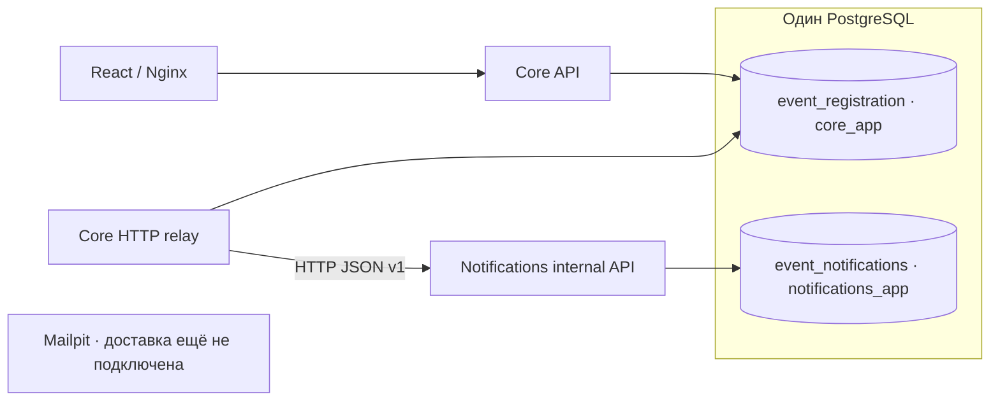

# Core и Notifications: инфраструктура и HTTP-передача

Это согласованное пользователем архитектурное решение, а не дополнительное обязательное требование PDF. Core остаётся в `backend/`, React — в `frontend/`; новый независимый Python-проект находится в `notifications/`.

## Реализовано сейчас

- Публичные Core API, бизнес-правила, routes и прежние миграции сохранены. Worker теперь выполняет HTTP relay; новая Core revision 0003 расширяет состояния outbox без добавления колонок.
- Notifications: FastAPI, AsyncEngine/AsyncSession, asyncpg, собственные зависимости/lock-файлы, Dockerfile, Alembic и тесты.
- Notifications предоставляет GET /health и защищённый POST /internal/v1/notifications. Задания фиксируются в собственной БД до 202; дубликат идентичного JSON безопасен, другой JSON с тем же ID даёт 409.
- Один PostgreSQL хранит две независимые прикладные БД; отдельного PostgreSQL-контейнера для Notifications нет.
- Core и Notifications проверяют только свою БД и свою Alembic revision. Core не зависит от процесса Notifications и его healthcheck.
- Отдельный bootstrap работает поверх уже существующего PGDATA. Init-скрипт для пустого volume не используется.
- CI сохраняет все Core/frontend проверки и добавляет проверки Notifications, изоляции ролей и доступности Core при остановленном Notifications.

HTTP relay и delivery retries до приёма задания реализованы. MIME rendering/freezing, SMTP, Kafka, Redis, новый UI и SSE пока не реализованы. HTTP 202 означает только приём; SMTP-доставка не заявляется. Подробный версионированный контракт и обработка устаревших снимков — [NOTIFICATION_PROTOCOL.md](NOTIFICATION_PROTOCOL.md).

## Владение данными и граница сервисов



Core владеет events, registrations и email_outbox (24 колонки). READ COMMITTED, event SELECT FOR UPDATE, отдельный MAX(waitlist_seq)+1 после lock, FIFO-продвижение внутри отмены, версии участия/переносов, билеты, токены и чекин не меняются. Никакого сетевого вызова из бизнес-транзакции не добавлено.

По последнему уточнению пользователя Core relay передаёт **неизменяемый payload**, а **Notifications будет формировать и сохранять MIME**. Подготовка Core payload и фиксация Notifications MIME — разные этапы, не leases. После сохранения MIME повторная отправка должна использовать прежние байты/Message-ID; это предстоит реализовать и проверить отдельно. Перед первой HTTP-попыткой Core фиксирует envelope v1 и prepared_at под event-lock; после этого payload не меняется. HTTP acceptance отмечается forwarded, не sent. Legacy prepared payload поддерживается как плоский v1-контекст без перезаписи; некорректный legacy payload остаётся failed с диагностикой.

## Базы и права

| Назначение | БД по умолчанию | Роль |
|---|---|---|
| Core API, Core migrations, существующий worker | event_registration | core_app |
| Notifications и его миграции | event_notifications | notifications_app |
| Bootstrap и резервные копии | postgres / нужная БД | прежний POSTGRES_USER, локальный технический администратор |

Обе прикладные роли: LOGIN, NOSUPERUSER, NOCREATEDB, NOCREATEROLE, NOREPLICATION, NOBYPASSRLS. Bootstrap отказывается переиспользовать привилегированную роль или роль с членством в других ролях. Имена двух БД/ролей должны отличаться, прикладные роли не могут совпадать с администратором.

На обеих БД отзывается доступ PUBLIC и чужой прикладной роли. Каждая роль владеет собственной БД/схемой и известными прикладными таблицами. PostgreSQL возвращает 42501 при попытке подключиться к чужой БД. Межбазовых FK, FDW и общих ORM-моделей нет. Технический администратор сохраняет доступ к обеим БД; сервисные контейнеры не получают его пароль.

Bootstrap использует SQL format(%I/%L) и psql-переменные для безопасного quoting, не вставляет секреты в shell SQL и не выводит их. ALTER OWNER выполняется адресно для известных таблиц, без REASSIGN OWNED всего кластера. Скрипты не удаляют строки/таблицы/БД и не вызывают initdb.

Один PostgreSQL остаётся общей точкой отказа и общим ресурсом CPU/диска. Разные БД/роли обеспечивают изоляцию доступа, но не аппаратную отказоустойчивость.

## Таблица Notifications

```text
notification_jobs:
  id            UUID PK, NOT NULL, без default — Core outbox UUID
  payload       JSONB NOT NULL — неизменяемый envelope v1
  mime          BYTEA NULL — место для будущего сохранённого MIME
  status        VARCHAR(12) NOT NULL DEFAULT 'pending'
  attempts      INTEGER NOT NULL DEFAULT 0
  available_at  TIMESTAMPTZ NOT NULL DEFAULT now()
  last_error    TEXT NULL
```

Семь колонок; status — pending/sent/failed, attempts >= 0, payload — JSON-объект, непустой MIME при наличии, sent требует MIME. Частичный индекс pending по available_at/id. Нет recipient/kind/версий отдельными колонками: они входят в типизированный payload. PK вместе с INSERT ON CONFLICT и сравнением нормализованного JSON обеспечивает идемпотентный приём; SMTP этим не реализован.

Notifications имеет собственный alembic_version и revision `0001_notification_jobs`; Core использует `0003_outbox_forwarded`. Downgrade Notifications на base разрешён только при пустой notification_jobs; при наличии заданий он явно останавливается, чтобы не уничтожить данные. На рабочей БД downgrade не запускать.

## Запуск и обновление существующего volume

Переменные `.env.example`:

```text
POSTGRES_DB, POSTGRES_USER, POSTGRES_PASSWORD — существующая БД и администратор
CORE_DB_USER, CORE_DB_PASSWORD — обычная роль Core
NOTIFICATIONS_DB, NOTIFICATIONS_DB_USER, NOTIFICATIONS_DB_PASSWORD — вторая БД/роль
```

Существующий `.env` не перезаписывать. Для новых переменных предусмотрены локальные defaults, совпадающие с `.env.example`, чтобы старый файл продолжил работать. Для своего окружения задайте отдельные пароли; в Compose DSN используйте URI-safe символы, как для прежнего Core URL. Примерные пароли не подходят для публикации сервиса.

Перед обновлением сохраните приватный дамп вне Git и резервную копию ролей. Затем:

```sh
docker compose build api notifications
docker compose up -d --wait --wait-timeout 120
```

Порядок: db healthy → db-bootstrap exit 0 → две независимые миграции → api/worker и notifications. Frontend зависит только от Core API. Bootstrap также можно вызвать явно:

```sh
docker compose run --rm --no-deps db-bootstrap
```

Для явного вызова БД уже должна работать. Bootstrap можно повторять: он сохраняет строки, UUID, билеты, хеши токенов, очередь, outbox, MIME и версии Alembic. Он создаёт отсутствующую вторую БД, обновляет пароли прикладных ролей из настроек, меняет права и владельцев. Пароль технического администратора этим скриптом не меняется. Если POSTGRES_PASSWORD в .env не соответствует уже созданному пользователю, bootstrap завершится ошибкой авторизации; удалять volume для исправления нельзя.

Имена существующих БД/ролей не являются инструкцией переименования: при смене этих настроек могут появиться другие БД/роли, прежние не удаляются. Сохраняйте POSTGRES_DB для работы с существующими данными. Откат Core к суперпользователю не требуется: исходный код работает с обычной ролью без изменений. Удаление Notifications из запуска не должно сопровождаться удалением его БД.

Проверки:

```sh
docker compose ps --all
docker compose exec -T api alembic check
docker compose exec -T notifications alembic check
docker compose exec -T notifications python -c 'import urllib.request; print(urllib.request.urlopen("http://localhost:8000/health", timeout=5).read().decode())'
docker compose stop notifications
curl --fail http://localhost:8080/api/health
curl --fail http://localhost:8080/api/events
docker compose up --no-build --no-deps -d --wait notifications
```

Notifications не публикует host-порт и не проксируется frontend; healthcheck выполняется внутри контейнера. PostgreSQL и Mailpit сохраняют прежние volumes. Не удалять volumes при обновлении. Локально останавливать тестовые окружения командой down без --volumes.

## Тесты

```sh
docker compose --profile test build test notifications-test bootstrap-test
docker compose --profile test run --rm test
docker compose --profile test run --rm notifications-test
docker compose --profile test run --rm bootstrap-test
docker compose --profile test run --rm --no-deps notifications-test ruff check .
docker compose --profile test run --rm --no-deps notifications-test ruff format --check .
docker compose --profile test run --rm --no-deps notifications-test mypy notifications_app
```

test-db — отдельный PostgreSQL в tmpfs, без основного volume. test-db-bootstrap создаёт обычные роли core_app_test и notifications_app_test и изолирует две тестовые БД. Теперь Core test-сервис по умолчанию выполняет и миграции, и весь Pytest под core_app_test, без административных credentials; его PostgreSQL-фикстура проверяет имя роли, отсутствие SUPERUSER/CREATEDB/CREATEROLE/REPLICATION/BYPASSRLS и членства в других ролях. Notifications-тесты проверяют собственную схему, AsyncSession/rollback, UUID/constraints, оба направления запрета доступа, непривилегированные роли, health и безопасный round-trip миграции только в *_test.

Автоматический тест `infrastructure/tests/test_bootstrap.py` запускается отдельным bootstrap-test. Это единственный Python test-контейнер с тестовыми административными credentials; они нужны для выполнения настоящего shell/psql bootstrap, а не для миграций или прикладных запросов. psql добавлен только в отдельный Docker target bootstrap-test; runtime и обычный Core test-образ не увеличены. Скрипты, тест и Notifications смонтированы read-only; Docker socket не передаётся.

Тест сначала проверяет точные тестовые имена БД/ролей и PGHOST=test-db, затем применяет миграции каждой БД под её обычным владельцем. Создаёт подтверждённую, ожидающую и отменённую регистрации, билет/чекин, версии участия/события, pending/sent/failed outbox и задания Notifications с сохранёнными MIME и ошибкой повторной попытки. Два повторных запуска bootstrap должны сохранить все строки обеих БД, включая alembic_version, владельцев БД/схемы/таблиц/индексов, ACL, определения индексов/constraints. Проверяются эффективные права на собственные объекты, отсутствие PUBLIC-доступа и чужих CONNECT/CREATE/TEMP, реальные отказы соединения 42501 в обоих направлениях до и после повторов. Очистка удаляет только UUID этого теста.

Наборы Core → Notifications → bootstrap-test выполняются последовательно: первые два делают downgrade/upgrade тестовых схем. Тест не воспроизводит остановку PostgreSQL/повреждение файловой системы и не доказывает атомарность bootstrap всего кластера: отдельные CREATE DATABASE не являются одной общей транзакцией.

При предыдущем инфраструктурном этапе дополнительно вручную проверялись заполненные постоянные БД до/после первого и повторного bootstrap. Теперь повторяемость с данными проверяется автоматически в CI на tmpfs; штатный Core Pytest использует core_app_test. Дополнительно проверяются v1-контракт и сквозная потеря HTTP-ответа с двумя БД; SMTP не реализован. Фактические команды, числа тестов и времена находятся в DEVELOPMENT_LOG.md.
