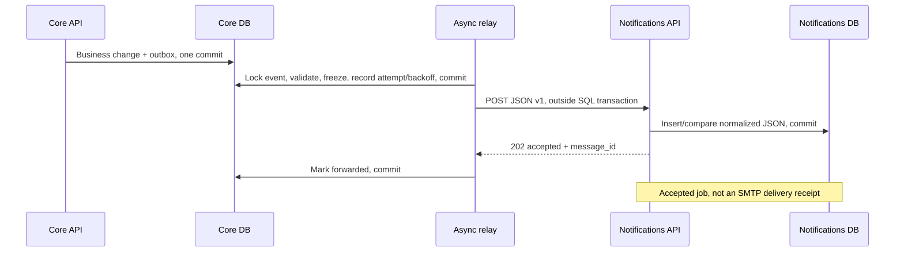

# Core -> Notifications: JSON v1 and delivery guarantees

This is the approved service split, not a requirement to use microservices in the PDF. Core retains registration, FIFO, cancellation/resume, tickets, check-in and atomic outbox creation. Notifications implements asynchronous SMTP; [SMTP_DELIVERY.md](SMTP_DELIVERY.md) describes its separate freeze boundary.



## HTTP contract

`POST /internal/v1/notifications`, JSON, `Authorization: Bearer <NOTIFICATIONS_INTERNAL_TOKEN>`. The shared technical secret is at least32characters, supplied only to relay/Notifications, not the Core API/frontend build. The endpoint is not published on the host or proxied by frontend. Plain HTTP is for the local Docker network; production service authentication/TLS remains future work.

[notification-contract-v1.schema.json](notification-contract-v1.schema.json) is the versioned artifact. Each independent Python project has its own Pydantic contract; CI compares both schemas against it and exercises cross-service delivery. There is no shared ORM/business runtime package or cross-database access.

```json
{
  "schema_version": 1,
  "message_id": "53ba21b4-3866-470d-ae73-bb5b2f264d68",
  "registration_id": "15c30b59-89d8-4416-ac83-9b018cd83d54",
  "kind": "ticket",
  "payload": {
    "recipient": "user@example.test",
    "event_id": "2efbf0c3-5848-45d1-ae36-92bdbb17358c",
    "description": "Example event",
    "starts_at": "2030-01-03T12:00:00Z",
    "schedule_version": 1,
    "participation_no": 1,
    "registration_status": "confirmed",
    "ticket_code": "example-ticket",
    "manage_path": "/registration#token=example-token",
    "old_starts_at": null,
    "new_starts_at": null
  }
}
```

- message_id is the original Core outbox UUID; retry does not generate another ID. registration_id is an identity, not a Notifications FK.
- schema_version is strict integer1. Unknown versions, bools in strict integer fields, extra fields, null characters, invalid dates/lengths or incompatible kind/payload combinations return422 without reflecting the submitted payload.
- Kinds: ticket/waitlist/reminder/rescheduled. Ticket requires confirmed status and a code. Waitlist has no ticket, even if promotion occurred before preparation of its initial waiting message. Rescheduled needs distinct old/new dates and new_starts_at=starts_at; other kinds do not carry those dates.
- New Core recipients are canonical lowercase ASCII emails. Legacy Unicode JSON is retained unchanged; MIME/SMTP compare canonical identity. [Email policy](EMAIL_CANONICALIZATION.md).
- Dates are timezone-aware and UTC-normalized. Optional fields normalize to null. Content identity compares normalized JSON, so key order, UUID spelling and equivalent date offsets do not create another command. Different recipient/kind/version/content under the same ID is a conflict.
- The management path is private database content. ACK, diagnostics and validation responses do not disclose it or recipient/body.

| Response | Meaning |
| --- | --- |
| 202 `{"message_id":"...","status":"accepted"}` | Notifications committed its own job; also returned for an identical repeat |
| 409 | Same ID, different normalized content; existing record unchanged |
| 401 | Missing/incorrect internal Bearer key |
| 422 | Invalid/unsupported contract, without echoing submitted values |
| 5xx/timeout/disconnect | Outcome may be ambiguous; Core retries original ID/content |

The ACK remains accepted even when the stored job is already sent/failed. Repeating HTTP never resets MIME, status, attempts, schedule or error. Concurrent inserts serialize on the unique PK; a post-conflict READ COMMITTED SELECT observes the committed JSON. Acceptance does not run SMTP or call Core.

Breaking changes require a new schema version: deploy receiver support alongsidev1 first, then the sender. Frozenv1 commands remainv1 through retries/deployments.

## Freshness and ordering

1. Core selects due work, closes that read session, then locks the event and rereads outbox/registration in a separate short transaction. Time is evaluated after acquiring the lock.
2. Before first preparation, cancelled/stale-generation commands are cancelled. Ticket/waitlist/reminder context can refresh to current event data while retaining the first private path. A reminder that is early is rescheduled; one that is unprepared after the start is cancelled. Future/incompatible versions or invalid contracts fail safely.
3. Each rescheduled command represents one historical move. Later moves do not overwrite its old/new dates/version. A stale participation generation can cancel it before preparation; valid historical moves of the current generation remain.
4. Before network, prepared_at and the completev1 envelope are committed. From there, ID and JSON are immutable. Retry rereads/revalidates but does not rewrite/cancel the frozen command: an earlier HTTP acceptance may have committed without an ACK. A subsequent cancellation/resume/move/start cannot retract an ambiguous accepted action.
5. Notifications accepts valid unique commands regardless of arrival order. It does **not** apply latest-wins or reactivate another job. A rescheduledv3 may arrive before ticketv1; deleting that ticket could lose the first management link. Notifications renders a historical snapshot, while Core determines current ticket validity and participation.

## Bounded selection without head-of-line blocking

Relay examines at most RELAY_CANDIDATE_LIMIT distinct event heads per pass (default20, range1–100). DISTINCT ON selects each event's first due pending item by `(available_at,id)`, so many messages from one locked event cannot fill the entire candidate page or let its later message bypass the head.

A UUID cursor rotates between events; one successful network attempt per run_once continues from another event next time. A UTC cutoff bounds each traversal; newly arriving work enters the next traversal. On wrap the cursor/cutoff reset; a call performs at most one repeat selection. The cursor is only an in-memory hint: durable pending work is rediscovered after restart.

Event acquisition uses FOR UPDATE NOWAIT. SQLSTATE55P03, including a PostgreSQL lock_timeout during prepare/update/commit, is handled **after rollback**. Skipping preserves payload, prepared_at, attempts, deadline and error. A new candidate gets a new AsyncSession. Other database errors remain visible to the worker's bounded failure/pause path.

If all candidates are blocked, run_once returns false and the worker waits normally. Subsequent pages eventually revisit skipped events; there is no busy infinite retry of the first row or permanent skip. Participant FIFO remains a Core business transaction, not relay ordering.

## Attempts, backoff and recovery

One async httpx client uses trust_env=False, no redirects, phase timeouts and a total asyncio deadline. SQL closes before HTTP/backoff/inter-iteration waiting. One active iteration is enforced by the [database singleton](OPERATIONS.md).

| Setting | Default |
| --- | --- |
| NOTIFICATIONS_URL | http://notifications:8000 |
| NOTIFICATIONS_INTERNAL_TOKEN | Required technical secret; public local example in Compose/.env.example |
| RELAY_TIMEOUT | 5seconds, total deadline and phase budgets |
| RELAY_MAX_ATTEMPTS | 8started attempts, including an attempt interrupted by a crash |
| RELAY_BACKOFF_BASE / CAP | 1 / 60seconds |
| WORKER_POLL_INTERVAL | 5seconds when no due work or after DB failure |
| RELAY_CANDIDATE_LIMIT | 20distinct event heads |

`min(cap,base*2^(attempts-1))` is persisted before HTTP for crash recovery, and recalculated from failed completion time. A valid202 with matching ID marks forwarded. Transport/deadline/408/429/5xx/invalid ACK retries until exhaustion. Other responses, including401/409/422/redirect/200 instead of202, fail without hidden endless retries. One failed ID does not block other due work.

| Failure point | Recovery |
| --- | --- |
| Before business commit | Participation/outbox roll back together |
| After business commit, before prepare | Pending remains; freshness checked later |
| After prepare commit, before HTTP | Same committed ID/JSON and recorded attempt/deadline after restart |
| Before Notifications commit | No successful ACK; retry can create the job |
| Notifications commit, lost ACK | Retry compares stored content and returns202 without another job |
| ACK received, Core crashes before forwarded | Same idempotent retry closes the ambiguity |
| Last allowed attempt interrupted | Exhausted job remains failed; operator diagnoses and retries explicitly |

No task is deleted on failure or silently given a fresh counter. An explicit `python -m app.notifications.retry UUID --acknowledge-duplicate-risk` only requeues failed while retaining ID/payload/prepared_at; normal prepare revalidates it. HTTP acceptance is durable, repeated transfer with bounded automatic retries, not a distributed transaction or unconditional eventual delivery. Prolonged outages beyond the budget need intervention.

## Schema and evidence

Core head0005 adds indexes;0004 canonicalizes registrations after collision audit without rewriting outbox;0003 added forwarded CHECK values. Core remains3tables/24columns. Downgrade from0003 rejects existing forwarded rows rather than falsely calling them SMTP-sent. Notifications head0001 retains7columns; HTTP stores the entire normalized envelope, MIME initiallyNULL.

Tests cover equivalent/conflicting/concurrent IDs, unknown versions, auth, strict fields, transactional rollback, deadlines, unavailable receiver, commit-before-ACK, process restart, stale/future versions, blocked events and lock-timeout rollback. Real CI probes exercise running services. Full commands and outcomes are historical records in DEVELOPMENT_LOG, not inferred from the existence of these fields.
